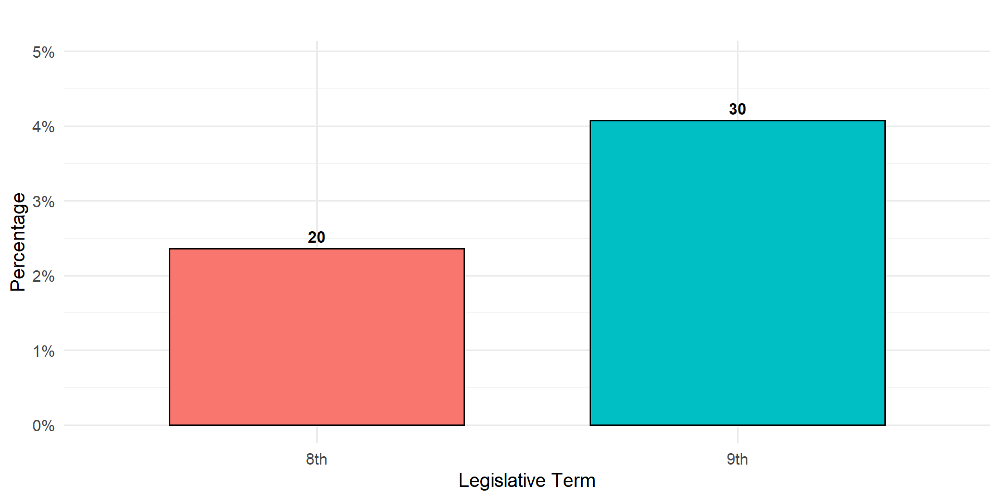
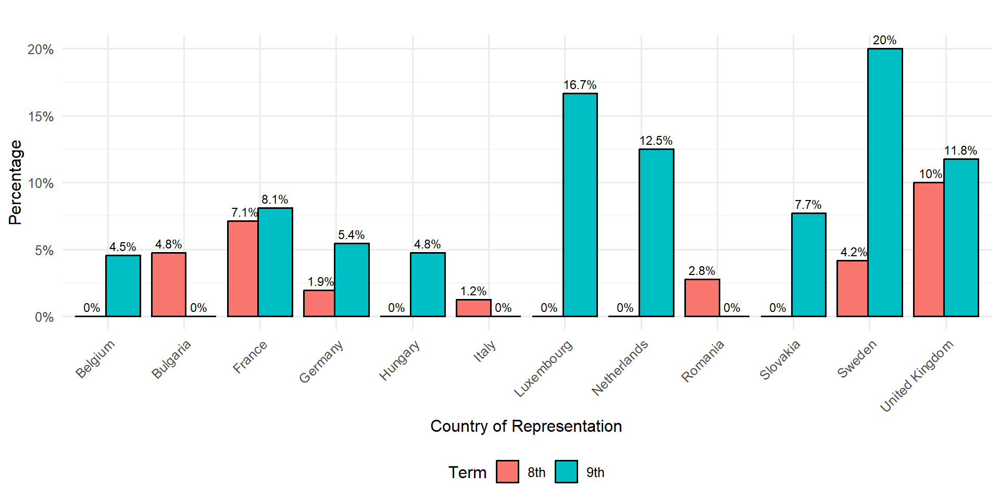

**Does Biography Matter? Minority Background, National
Anti-Discrimination Frameworks, and Legislative Attention in the
European Parliament**

Zeynep Mentesoglu Tardivo (University of Milan)

Federico Russo (University of Salento)

**ABSTRACT**

Migrant-origin and racialised minorities remain underrepresented in
European political institutions, raising a central question in research
on descriptive and substantive representation: whether, and under what
conditions, minority presence translates into legislative attention to
concerns affecting these groups. Theoretical approaches offer different
perspectives on how representatives' backgrounds may shape legislative
behaviour. Theories of group and gyroscopic representation suggest that
representatives' backgrounds and experiences may shape the issues they
prioritise, while constructivist approaches caution that biography does
not automatically determine political behaviour. Against this
background, this article examines whether Members of the European
Parliament (MEPs) with migratory or racialised minority backgrounds
devote greater attention to discrimination-related issues and whether
this association varies across national anti-discrimination policy
contexts. Drawing on the EUQuest dataset, we combine approximately
180,000 written parliamentary questions with original biographical data
on MEPs and country-level MIPEX anti-discrimination scores across 27 EU
Member States (all covered by MIPEX; Malta, not assessed by MIPEX, is
not included). Using Bayesian multilevel count models, we analyse
MEP-year variation in discrimination-related parliamentary questioning.
At the model's relevant reference values, minority background is
associated with substantially more discrimination-related questioning,
whereas the MIPEX score shows no clearly identifiable independent
association. Their interaction is small and not credibly different from
zero in either specification, and the specification-specific estimates
are not robust in sign: the evidence for a conditional amplification of
the minority-attention gap across national anti-discrimination policy
contexts is therefore weak. Right-wing nationalist affiliation shows a
positive but imprecisely estimated association with
discrimination-related questioning — one that is credible under a more
conservative keyword-based measure reported in the Appendix — underscoring that issue attention
should not automatically be equated with pro-minority substantive
representation. By integrating
representatives' biographies and national anti-discrimination policy
contexts within a single comparative framework, the study moves beyond
asking whether biography matters to identifying the conditions under
which it matters. More broadly, the findings advance debates on
descriptive and substantive representation by showing that the political
relevance of minority presence is conditional on institutional context
and that legislative attention alone should not be taken as evidence of
substantively favourable representation.

**Keywords:** political representation; migrant-origin representatives;
Members of the European Parliament (MEPs); anti-discrimination policy;
legislative attention; parliamentary questions

1.  **Introduction**

Whose demands are heard within representative institutions and
translated into legislative attention is a fundamental question of
democratic representation. Representation is commonly understood as an
interactive process through which societal preferences are communicated
to political elites and may subsequently shape political agendas and
decisions (Pitkin, 1967; Mansbridge, 2003; Saward, 2010; Wolkenstein &
Wratil, 2021). Yet, access to this process is unevenly distributed. A
substantial literature demonstrates that differences in socioeconomic
resources, political participation, and proximity to decision-makers can
translate into unequal political influence, with the preferences of more
advantaged groups often receiving greater attention from political
elites (Gilens & Page, 2014; Peters & Ensink, 2015; Elsässer et al.,
2021; Schakel et al., 2020).

Some scholars noted that the broader inequalities in political voice and
representation are pronounced among migrants and their descendants, who
may face disadvantages at multiple stages of the representative process,
from access to elected office to the influence they exercise once
elected (Mügge & Erzeel, 2016; Auer et al., 2025). At the entry stage,
non-citizen migrants in Europe are often formally excluded from
electoral arenas (Arrighi & Bauböck, 2017), while migrant-origin
populations remain descriptively underrepresented within legislative
institutions (Auer et al., 2025; Dancygier et al., 2015). Comparative
evidence from five European countries[^1] shows that, despite some
progress, the share of immigrant-origin MPs generally remains below
their corresponding population share (Bergmann et al., 2025). This gap
may reflect not only broader inequalities in political recruitment but
also discriminatory practices within candidate selection and electoral
competition, including the lower selection rates of migrant-origin
aspirants and their placement in less competitive constituencies or
lower positions on electoral lists (Holtkamp et al., 2023; English,
2022; Auer et al., 2025). These barriers matter beyond descriptive
inclusion, as the underrepresentation of such groups may also reduce the
opportunities for their experiences and concerns to receive sustained
legislative attention (Mansbridge, 1999; Saalfeld & Bischof, 2013;
Sobolewska et al., 2018).

Yet reaching elected office does not necessarily eliminate these
inequalities. Research on the Swedish parliament documents recurrent
direct and indirect discrimination against MPs with immigrant
backgrounds, both within the parliamentary workplace and in their
interactions with the public (Albertsson & Erikson, 2025). Similar
patterns emerge from the comparative REPCHANCE Europe study, in which
migrant-origin elected representatives reported discrimination, hate
speech, and tokenism, with women in particular describing intersecting
forms of racism and sexism (Bergmann et al., 2025). Representatives also
reported being expected to concentrate on migration and integration
issues, even when these areas fell outside their expertise or broader
political interests. In Germany and Switzerland, for example,
migrant-origin politicians described diversity as partly performative:
migration-related portfolios were frequently assigned to them, while
their opportunities to demonstrate expertise in other policy domains
remained constrained (Bergmann et al., 2025).

This evidence reveals an important ambiguity for the relationship
between descriptive and substantive representation. Shared experiences
of migration, racialisation, or exclusion may make minority-background
representatives more attentive to discrimination-related concerns, but
institutional expectations may simultaneously instrumentalise their
backgrounds and narrowly define the issues and constituencies they are
expected to represent. Descriptive presence, therefore, does not by
itself determine whether, or under what conditions, the concerns of
migrant-origin and racialised minorities receive substantive legislative
attention.

Against this backdrop, this article investigates whether MEPs' migratory
or racialised minority backgrounds constitute a distinct biographical
channel of representation, increasing their likelihood of raising
discrimination-related issues in the European Parliament. In doing so,
it engages with a central puzzle between theories of group
representation and constructivist approaches to political
representation. While the former emphasise how descriptive presence may
advance substantive representation and social justice (Phillips, 1995,
2023; Williams, 1998; Mansbridge, 1999), constructivist accounts stress
that identities and group interests are not socially given but are
actively interpreted and constituted through representative claims
(Laclau, 2005; Urbinati, 2006; Saward, 2010). The article therefore
treats minority background as a potential representational resource
rather than assuming that it automatically translates into particular
legislative behaviour. It asks both whether representatives' backgrounds
are associated with discrimination-related attention and whether this
association varies with the strength of national anti-discrimination
frameworks. In this way, the analysis assesses whether biography and
national context operate independently or interact in shaping
parliamentary attention to discrimination.

Empirically, the study combines country-level and individual-level data
across 27 EU Member States (all covered by MIPEX). National anti-discrimination contexts are
measured using MIPEX scores, which capture the strength of legal
protections, equality policies, and institutional mechanisms addressing
ethnic, racial, religious, and nationality-based discrimination.
Legislative attention is measured using the EUQuest dataset, comprising
approximately 180,000 written parliamentary questions tabled in the
European Parliament. The European Parliament provides a particularly
useful setting because MEPs operate within a common supranational
institution while being elected in countries with different national
policy environments. Written questions are especially suitable for
examining individual issue prioritisation because they allow MEPs
greater discretion than more strongly party-disciplined activities such
as legislative voting (Russo & Wiberg, 2010; Mügge et al., 2019).

We further link these legislative data to an original, hand-coded
biographical dataset identifying MEPs with first- or second-generation
migratory backgrounds or racialised minority backgrounds across the
seventh, eighth, and ninth parliamentary terms (2009--2024). Extending
the analysis across three legislatures increases the number of
minority-background MEPs observed and captures variation in
parliamentary composition and national policy contexts, including the
heightened politicisation of migration around 2015. While numerous
studies have documented inequalities in political participation and
representation between migrant-origin and non-migrant populations, to
the best of our knowledge, this is the first study to examine whether
MEPs' biographical backgrounds are associated with
discrimination-related legislative attention while explicitly accounting
for cross-national variation in national anti-discrimination policy
frameworks.

The remainder of the article is structured as follows. The next section
develops the theoretical framework and hypotheses, followed by a
discussion of the data, measures, and modelling strategy. The subsequent
section presents the empirical results. The conclusion then discusses
their theoretical implications, the study's contributions and
limitations, and directions for future research.

2.  **Theoretical Framework and Hypotheses**

Political representation concerns both *who representatives are* and
*what they do*. Descriptive representation refers to the presence of
members of particular social groups within political institutions,
whereas substantive representation concerns whether representatives
advance interests and concerns associated with those groups (Pitkin,
1967). In Pitkin's original formulation**,** descriptive representation
was primarily a matter of resemblance: representatives "stand for"
others because they share certain characteristics with them, rather than
because they act on their behalf. Theories of group representation and
the politics of presence subsequently challenged this separation,
arguing that the inclusion of historically marginalised groups can
strengthen political equality and democratic legitimacy while bringing
previously overlooked experiences, perspectives, and policy concerns
onto institutional agendas (Phillips, 1995; Williams, 1998; Mansbridge,
1999).

A central tension nevertheless emerges within this literature. On the
one hand, persistent patterns of exclusion and inequality give
particular weight to arguments for the institutional inclusion and
political voice of marginalised groups. Shared experiences of
disadvantage may provide representatives with knowledge and perspectives
on concerns that have historically received limited attention from
dominant groups. On the other hand, descriptive presence does not
automatically translate into substantive representation. Members of
marginalised groups do not necessarily share the same interests,
political preferences, or interpretations of collective concerns, and
representatives may vary in the extent to which they identify with or
seek to represent particular constituencies (Williams, 1998; Young,
2000; Dovi, 2002). Migratory or racialised minority background should
therefore be understood as a potential representational resource, rather
than as an automatic predictor of legislative behaviour.

Political representation can, however, operate through different
representative logics. Classical accounts distinguish between delegate
representation, in which representatives rely more closely on
constituents' preferences, and trustee representation, in which they
exercise greater independent judgement. More recent accounts distinguish
additional forms, including promissory, anticipatory, surrogate, and
gyroscopic representation (Mansbridge, 2003; Rehfeld, 2009, 2011). These
models point to different sources of representative behaviour, ranging
from constituent preferences and electoral commitments to
representatives' own judgement and internally held principles.

Among these models, *gyroscopic representation* is particularly relevant
to the present argument because it provides a mechanism through which
biography may shape political action. Whereas conventional accounts
emphasise party discipline, electoral incentives, and explicitly
communicated constituency demands, gyroscopic approaches suggest that
representatives also rely on internally held principles, understandings
of interest, and forms of "common sense" shaped by their personal
experiences, social positions, and political socialisation (Mansbridge,
2003; Burden, 2007). Social background may therefore operate as a
cognitive lens through which representatives interpret political
problems and prioritise competing issues. Experiences of migration,
racialisation, exclusion, or discrimination may consequently influence
which forms of inequality representatives recognise as politically
salient and worthy of legislative attention (Sobolewska et al., 2018).
Consistent with this mechanism, candidates with immigrant backgrounds
have been found to express stronger beliefs that members of their own
group are particularly well placed to represent that group's interests,
although such orientations may be moderated by parliamentary experience
and institutional socialisation (Coffé & Reiser, 2018).

*Constructivist theories* provide an important qualification to this
biographical argument. They reject the assumption that identities and
group interests are fixed, pre-political, or automatically transmitted
through descriptive representation. Rather, representatives actively
interpret the interests, identities, and constituencies they claim to
represent, while adapting their claims to different audiences and
institutional settings (Laclau, 2005; Urbinati, 2006; Saward, 2010). The
political relevance of a particular biographical characteristic may
consequently vary across representatives and contexts. Migratory or
racialised minority background may provide experiential knowledge and
connections to affected communities, but representatives retain agency
over whether and how these resources are translated into legislative
action (Saward, 2014; Bajpai, 2019).

Empirical research suggests that representatives' backgrounds
nevertheless can be associated with their legislative priorities.
Studies of German legislatures find that representatives with migratory
backgrounds devote greater attention to migration- and
integration-related issues than representatives without such backgrounds
(Donovan, 2012; Wüst, 2014). Evidence from the British House of Commons
similarly shows that minority MPs submit more parliamentary questions
concerning immigration and ethnic-minority rights than comparable
non-minority MPs (Saalfeld & Bischof, 2013). These findings suggest that
biography can shape both how political actors understand representation
and which issues they prioritise, while leaving substantial room for
variation arising from party affiliation, ideology, institutional
position, political socialisation, and individual identification.

The form of legislative activity may also influence whether such
biographical orientations become observable. In strongly
party-disciplined activities such as roll-call voting, representatives
have relatively limited scope to act independently. Relationships
between descriptive and substantive representation may therefore be more
visible in parliamentary questions, debates, and committee activity,
where legislators generally have greater discretion over which issues to
select and how to frame them (Bird, 2011; Celis, 2008; Minta &
Sinclair-Chapman, 2013; Saalfeld & Bischof, 2013; Toró, 2018).

Written parliamentary questions are particularly useful for examining
such patterns in the European Parliament. They allow individual MEPs to
raise issues, request information, and signal political concern. Because
representatives must allocate attention across numerous competing policy
matters, submitting a question on discrimination reflects a decision to
devote parliamentary attention to that issue. Written questions may also
serve strategic purposes, allowing representatives to demonstrate
responsiveness, enhance their individual reputations, and signal concern
for constituency interests (Russo & Wiberg, 2010). A
discrimination-related question should therefore be interpreted as
evidence of issue prioritisation, rather than as definitive evidence
that an MEP explicitly claims to represent a particular minority group
or consciously invokes their biography as a source of political
authority.

Taken together, these arguments suggest that migratory or racialised
minority background may be associated with greater
discrimination-related legislative attention without determining
representatives' behaviour uniformly. We therefore expect:

> **H1.** MEPs with migratory or racialised minority backgrounds are
> more likely than their colleagues without such backgrounds to submit
> parliamentary questions addressing discrimination-related issues.

The political relevance of biography may also depend on the
institutional context in which representatives operate. MEPs are elected
in national contexts that differ substantially in the strength of their
anti-discrimination policy frameworks. *Policy-feedback theory* suggests
that policies do not merely reflect prior political demands; once
enacted, they can reshape subsequent political processes by altering the
resources, incentives, information, and interpretive cues available to
political actors (Pierson, 1993). Mettler and Soss (2004) similarly
emphasise that public policies can influence how political problems are
understood and structure opportunities for subsequent political action.

Applied to anti-discrimination policy, stronger frameworks may generate
both resource and interpretive effects. At the resource level, more
comprehensive legal protections, enforcement mechanisms, and equality
institutions provide procedures, expertise, information, and
institutional venues through which discrimination-related concerns can
be articulated and scrutinised. At the interpretive level, such
frameworks signal that discrimination constitutes a recognised and
legitimate object of public intervention and provide political actors
with legal categories and policy language through which to frame related
concerns. Stronger anti-discrimination frameworks may therefore increase
the visibility and political salience of discrimination-related issues
among MEPs irrespective of their own backgrounds. This leads to our
second hypothesis:

> **H2.** MEPs elected in countries with stronger anti-discrimination
> policy frameworks are more likely to submit parliamentary questions
> addressing discrimination-related issues.

However, the relationship between descriptive and substantive
representation is unlikely to be uniform across institutional contexts.
Existing research increasingly treats substantive representation as
conditional, showing that the political consequences of descriptive
presence depend partly on the institutional opportunities available to
representatives (Preuhs, 2006; Hänni, 2017). This expectation is also
consistent with political opportunity structure approaches, which
emphasise that institutional arrangements can enable, constrain, and
channel the articulation of minority-related political claims (Koopmans
& Statham, 1999; Koopmans, 2004).

Applied to anti-discrimination policy, this suggests that national
frameworks may shape not only the overall salience of discrimination but
also the extent to which biographically grounded concerns can be
translated into parliamentary attention. Policy-feedback theory provides
a mechanism for this expectation. Stronger anti-discrimination
frameworks may provide political actors with institutional resources,
including legal categories, enforcement mechanisms, equality bodies,
expertise, and information. They may also produce interpretive effects
by signalling that discrimination is a recognised and legitimate public
problem and by providing a policy language through which related
concerns can be articulated (Pierson, 1993; Mettler & Soss, 2004). These
institutional resources and interpretive cues, however, need not be
equally relevant to all representatives.

Gyroscopic representation provides a reason to expect
minority-background MEPs to be particularly sensitive to these
institutional opportunities. If representatives draw partly on
experiences and understandings formed through their social positions and
political socialisation (Mansbridge, 2003), experiences of migration,
racialisation, exclusion, or discrimination may make anti-discrimination
issues more readily recognisable as politically salient. Stronger
national frameworks may then provide the institutional language,
recognised categories, and policy resources through which such concerns
can more easily be articulated within parliamentary activity. In this
sense, biography and policy context may operate complementarily:
biography may shape which problems representatives are particularly
attentive to, while stronger anti-discrimination frameworks create more
favourable conditions for translating that attention into legislative
action.

This argument does not imply that minority-background representatives
necessarily identify with or act on behalf of minority constituencies.
Rather, it suggests that where biographical experiences make
discrimination-related concerns politically relevant, institutional
contexts can affect the extent to which those concerns become visible in
legislative activity. Evidence from the comparative REPCHANCE Europe
study is consistent with this expectation, showing that migrant-origin
politicians frequently relate their political trajectories to
experiences of discrimination, commitments to social justice and public
service, critical political events, and political mobilisation (Bergmann
et al., 2025).

The implication is therefore not simply that biography and national
context exert separate influences. Rather, the association between
national anti-discrimination frameworks and discrimination-related
legislative attention may be stronger among minority-background MEPs
because the institutional resources and interpretive cues provided by
stronger frameworks may be particularly relevant to representatives
whose experiences already make such concerns salient.

Accordingly, our third hypothesis is as follows:

> **H3.** The positive relationship between the strength of national
> anti-discrimination policy frameworks and MEPs' attention to
> discrimination-related issues will be stronger among MEPs with
> migratory or racialised minority backgrounds than among their
> colleagues without such backgrounds.

3.  **Data**

The empirical investigation draws primarily on data from the EUQuest Project, which provides systematic information on issue attention and representative characteristics in the European Parliament. EUQuest contains approximately 180,000 Questions for Written Answer submitted in the European Parliament between 1994 and 2024 and classified according to the Comparative Agendas Project coding scheme by fine-tuned LLaMA model, validated against human coding (Carammia, Iacus, and Porro 2026). It also provides information on the political and institutional characteristics of MEPs serving during this period. For the present study, we use observations from the seventh, eighth, and ninth parliamentary terms (2009--2024) and link them to an original, hand-coded biographical dataset identifying MEPs with first- or second-generation migratory backgrounds or racialised minority backgrounds. The 2009--2024 period covers the three most recent completed parliamentary terms, covering a the periods before and after the heightened salience of migration in public and political debate which was triggered by the refugee crisis in 2015. The analysis covers MEPs elected in all EU Member States covered by the Migrant Integration Policy Index (MIPEX) — that is, 27 of the 28 EU Member States; Malta, which MIPEX does not assess, is therefore excluded.

The individual-level data are complemented with country-level information from the Migrant Integration Policy Index (MIPEX)[^2]. Specifically, we use the MIPEX anti-discrimination score to capture the strength of national legal and institutional frameworks addressing discrimination on grounds including racial or ethnic origin, religion, and nationality. Higher scores indicate more comprehensive legal protections and institutional mechanisms. Importantly, the measure captures the formal anti-discrimination policy framework rather than the prevalence or individual experience of discrimination.

Because MIPEX assessments are not available annually for every country, scores are matched to MEP-year observations using the assessment corresponding to the same country and year where available. When no assessment is available for a given year, we use the most recent preceding MIPEX observation rather than assigning a later score retrospectively. The MIPEX reference year used in each match is retained in the dataset to ensure transparency in the temporal alignment of parliamentary behaviour and national policy context. In addition to the country-year measure used in the main analysis, parliamentary-term measures are constructed as an alternative specification of the national policy environment.

4.  **Concepts and Measures**

The operationalisation process was carried out as follows.

The dependent variable, *parliamentary attention to discrimination* is measured as the annual number of Questions for Written Answer submitted by each MEP and classified under Comparative Agendas Project minor-topic code 201, "Ethnic Minority and Racial Group Discrimination," and verified as within the substantive scope of the study through the validation protocol described below. The measure therefore captures the extent to which individual MEPs devote parliamentary attention to discrimination-related issues in a given year. Under the refined validated definition adopted here, the measure comprises 784 written questions (378, 301, and 105 across the three terms), which account for approximately 0.6 per cent of all written questions submitted over the period. At least one discrimination-related question was submitted by 143 MEPs in the seventh legislature, 129 in the eighth, and 54 in the ninth.
The automated classification of parliamentary questions at the CAP minor-topic level has an estimated accuracy of approximately 75 percent, so the substantive validation of the dependent variable is central to the design. Following the initial keyword-based construction, the full set of 1,309 questions retained under that definition — which combines CAP code 201 with conservative keyword screens and the hand-coding decisions described in Appendix B — was screened in two independent passes by a large-language model under a refined rubric asking whether each question addresses the discrimination of ethnic or racialised minorities within the European scope of the study, with the two runs pooled by majority voting. Every question flagged OUT by the majority vote was re-adjudicated by one of the authors, as were all candidates newly flagged IN below the majority threshold; residual disputes were resolved by hand and recorded. To validate the protocol itself, the refined rule and the keyword-based rule were benchmarked against an arbitrated gold standard of 334 hand-coded questions: the refined rule reaches a precision of approximately 90 per cent (against approximately 74 per cent for the keyword-based rule) at essentially the same recall (approximately 80 versus 81 per cent). The refined operationalization adopted in the main analysis therefore retains 529 of the keyword-retained questions confirmed in scope (524 confirmed by the refined screening, plus 5 questions hand-coded as within scope) and adds 255 questions positively verified as in scope that the keyword definition had missed, for a total of 784 question-level events. Because the refined measure removes only cases whose classification could not be confirmed and adds only cases positively verified as such, the positive-classification noise that attenuates keyword-based claim-making measures is substantially reduced. The keyword-based measure (1,319 events) is retained as a conservative alternative operationalization and analysed in full in Appendix B.
The principal individual-level independent variable identifies *MEPs with a migratory or racialised minority background*. MEPs were classified as having a migratory background if they were first-generation migrants originating from a non-EU country outside the Global North or, in the case of the second generation, if at least one parent originated from such a country. Roma MEPs are also included because they belong to a racialised minority exposed to persistent ethnic discrimination (Zevnik & Russell, 2026).

Eventually, this procedure identified **28 MEPs in the seventh
legislature,** 21 in the eighth, and 23 in the ninth as having a
migratory or racialised minority background. As shown in Figure 1, both
the number and proportion of minority-background MEPs varied across the
three parliamentary terms, while remaining a relatively small share of
the Parliament overall.

{width="4.91666447944007in"
height="2.4583333333333335in"}

**Figure 1.** MEPs with a migratory or racialised minority background by
parliamentary term

The European Network Against Racism provides a useful external
descriptive benchmark for comparing our estimates of the presence of
MEPs with migratory or racialised minority backgrounds in the European
Parliament. ENAR defines racialised-minority representatives as MEPs who
"either identify as non-white or identify as belonging (also) to a
non-EU country that is not in the Global North, or both" (ENAR 2024,
54). On this basis, ENAR estimates that racialised minorities accounted
for 3.3 per cent of MEPs in the eighth legislature and 4.5 per cent in
the ninth before the United Kingdom's withdrawal, corresponding to 28
and 39 MEPs respectively.

Our individual-level counts are lower than ENAR's aggregate estimates.
One possible explanation is the conservative coding approach adopted in
this study: minority-background status was assigned only where publicly
available biographical information was sufficient to verify it, meaning
that some minority-background MEPs may therefore not be identified by
our indicator. The discrepancy may also reflect differences in the
sources consulted, the population considered, or individual
classification decisions. Because ENAR does not publish the names of the
MEPs included in its classification, these possibilities cannot be
assessed directly. ENAR's estimates are therefore treated as an external
descriptive benchmark rather than as a direct validation of our
indicator. Nevertheless, both sources point to an increase in the
descriptive representation of MEPs with migratory or racialised minority
backgrounds between the eighth and ninth parliamentary terms, while
indicating that their overall presence remained limited. This pattern is
consistent with the wider literature documenting the persistent
underrepresentation of migrant-origin and racialised minorities in
European political institutions (Bloemraad, 2013; Bloemraad &
Schönwälder, 2013; Dancygier et al., 2015; Auer et al., 2025).

Beyond this overall pattern, the presence of MEPs with migratory or
racialised minority backgrounds varied substantially across national
delegations and parliamentary terms, as shown in Figure 2.

{width="6.5in" height="3.250317147856518in"}

**Figure 2.** Percentage of MEPs with a migratory or racialised minority
background by country and parliamentary term

Regarding the country-level independent variable, the national
anti-discrimination policy context is measured using the
anti-discrimination component of the Migrant Integration Policy Index
(MIPEX). The indicator evaluates the extent to which national laws,
policies, enforcement mechanisms, and equality bodies protect
individuals against discrimination based on racial or ethnic origin,
religion, and nationality. Scores range from 0 to 100, with higher
values indicating more comprehensive anti-discrimination frameworks. The
measure captures the formal legal and institutional context rather than
the prevalence of discrimination or the effectiveness of implementation
in practice.

MIPEX scores were merged with the individual-level data by country of
election and observation year. This country-year merge provided complete
MIPEX information for all observations included in the analytical
sample. Appendix Table A1 reports the MIPEX scores used for each country
and year during the period analysed.

To test the hypotheses, we estimated Bayesian zero-inflated negative
binomial generalised linear mixed models. This specification was chosen
because the dependent variable is an overdispersed count and contains a
large number of zero observations, corresponding to MEP-years in which
no discrimination-related question was submitted.

The models include random intercepts for each MEP and for each country
to account for repeated observations, unobserved individual
differences, and unobserved country-level heterogeneity, and the annual
number of written questions submitted by each MEP enters the models as
an offset. Because membership of the LIBE Committee may itself be
shaped by MEPs' backgrounds and interests, committee membership is
treated as a potential pathway rather than a pure confounder, and the
analysis therefore reports two specifications of the same model. The
first (M1) estimates the total association between MEPs' migratory or
racialised minority background and discrimination-related questioning,
omitting LIBE Committee membership; the second (M2) estimates this
association net of Committee membership by adding the LIBE indicator as
a control. In both specifications the fixed effects comprise MEPs'
migratory or racialised minority background, gender, party family, the
national Economic Discomfort Index (Misery Index), and the MIPEX
anti-discrimination score, together with the interaction between MEPs'
minority background and the MIPEX score. This interaction assesses
whether the association between the national anti-discrimination
policy framework and parliamentary attention to discrimination differs
between minority-background and other MEPs. The models are estimated on
a panel of 10,955 MEP-year observations covering 1,707 MEPs from 27
countries between 2009 and 2024, with identical priors and sampling
settings used throughout: weakly informative Student-t(3, 0, 2.5)
priors on the regression and zero-inflation coefficients, brms defaults
for the random-intercept standard deviations, and four chains of 4,000
MCMC iterations with 1,500 warm-up samples per chain;
convergence diagnostics (Rhat < 1.01 across all parameters,
adequate effective sample sizes, no divergent transitions) are
satisfied for all reported fits.

5.  **Findings**

Table 1 presents the posterior estimates from the two Bayesian
zero-inflated negative binomial models introduced in the previous
section: the total-effect specification (M1) and the direct-effect
specification (M2) that additionally controls for LIBE Committee
membership. In Bayesian analysis, a parameter is considered to have a
credible effect if its 95% credible interval excludes zero. The
analysis examines whether MEPs' migratory or racialised minority
backgrounds are associated with greater attention to
discrimination-related issues and whether this relationship varies
according to the strength of the anti-discrimination policy framework in
their countries of election.

The findings in the two models indicate that *H1* is supported at the
models' reference values. The estimated coefficient for minority
background is positive, and its 95 per cent credible interval excludes
zero in both specifications (β = 1.543, 95% CrI \[0.760, 2.297\] without
the LIBE control; β = 1.525, 95% CrI \[0.756, 2.246\] with it). Because
the models include an interaction with the centred MIPEX score, this
coefficient represents the estimated difference between
minority-background and other MEPs in a country with an average level
of anti-discrimination policy protection. On the exponentiated scale,
minority-background MEPs are estimated to submit about 4.7 times as
many discrimination-related questions as their colleagues (95% CrI
\[2.14, 9.94\]) in the total-effect specification, and 4.6 times as
many (95% CrI \[2.13, 9.45\]) once LIBE Committee membership is held
constant, at the reference MIPEX level and holding the other predictors
constant. The near-identity of the two estimates indicates that
committee assignment accounts for only a negligible share of the
minority-background gap. This result should not, however, be read as an
unconditional statement that the gap is identical everywhere: the
interaction reported for both models in Table 1 allows for variation
across national policy contexts, although, as discussed below, that
variation itself is not estimated with sufficient precision.

*H2* anticipated that MEPs elected in countries with stronger
anti-discrimination policy frameworks would devote greater parliamentary
attention to discrimination-related issues. The estimated coefficient
for the MIPEX score is small and positive, and its 95 per cent credible
interval includes zero, if only barely, in both specifications (β =
0.012, 95% CrI \[−0.001, 0.024\]; β = 0.011, 95% CrI \[−0.002, 0.023\]).
The findings therefore provide no clear evidence that stronger national
anti-discrimination frameworks are independently associated with more
frequent discrimination-related questioning. H2 is consequently not
supported. This suggests that the formal recognition and
institutionalisation of anti-discrimination principles at the national
level do not, by themselves, uniformly translate into greater
parliamentary attention to discrimination in the European Parliament.

*H3* anticipated that the relationship between MEPs' migratory or
racialised minority backgrounds and discrimination-related parliamentary
attention would become stronger as national anti-discrimination policy
frameworks became more comprehensive. The interaction between minority
background and the centred MIPEX score is small in magnitude, and its
95 per cent credible interval includes zero in both specifications
(β = 0.005, 95% CrI \[−0.051, 0.060\]; β = −0.003, 95% CrI
\[−0.058, 0.051\]). On the exponentiated scale, for each 1-unit increase
in a country's MIPEX score, minority MEPs are estimated to submit about
0.5 per cent more discrimination-related questions (95% CrI \[−5.0%,
+6.2%\]) in the total-effect specification, and about 0.3 per cent
fewer (95% CrI \[−5.6%, +5.3%\]) once LIBE Committee membership is held
constant. The findings therefore do not provide support for H3: not
only are both credible intervals indistinguishable from zero, but the
two specifications do not even agree on the sign of the interaction, so
the direction of any conditional pattern cannot be established in these
data.

More specifically, the estimation does not support the claim that the
difference in discrimination-related questioning between
minority-background and other MEPs increases as MIPEX scores rise: the
point estimates are small, the credible intervals are wide, and their
signs are not stable across specifications. The evidence for the
conditional pattern anticipated by H3 is therefore weak at this stage:
the greater attention to discrimination by minority-background MEPs is
supported across the range of national policy contexts covered by the
sample, while any additional variation attributable to MIPEX is not
credibly identified.

**Table 1.** Posterior estimates from the two Bayesian zero-inflated
negative binomial specifications (M1: total effect; M2: direct effect);
refined (LLM-verified) dependent variable

| **Predictor** | **M1: β (SE)** | **M1: 95% CrI** | **M1: Exp(β)** | **M2: β (SE)** | **M2: 95% CrI** | **M2: Exp(β)** |
|:-------------------------|----------------:|:----------------------|---------------:|----------------:|:----------------------|---------------:|
| *(Intercept)* | −6.4006 (0.2388) | [−6.8753, −5.9359]{.underline} | 0.0017 | −6.4592 (0.2350) | [−6.9287, −6.0060]{.underline} | 0.0016 |
| *Gender: Male* | −0.1601 (0.1324) | [−0.4217, 0.1018] | 0.8521 | −0.1078 (0.1305) | [−0.3565, 0.1506] | 0.8978 |
| *Misery Index* | 0.0102 (0.0081) | [−0.0054, 0.0260] | 1.0103 | 0.0095 (0.0081) | [−0.0065, 0.0256] | 1.0096 |
| *PartyFamily (Ref. Christian Democrats)* |   |   |   |   |   |   |
| *The Left* | 0.8801 (0.2520) | [0.3881, 1.3782]{.underline} | 2.4111 | 0.8782 (0.2500) | [0.3852, 1.3691]{.underline} | 2.4065 |
| *Eurosceptic Conservatives* | −0.0743 (0.3012) | [−0.6780, 0.5024] | 0.9284 | −0.0550 (0.2993) | [−0.6619, 0.5178] | 0.9464 |
| *Eurosceptics* | 0.9901 (0.2764) | [0.4417, 1.5314]{.underline} | 2.6914 | 1.0071 (0.2715) | [0.4757, 1.5450]{.underline} | 2.7378 |
| *Greens-EFA* | 0.8183 (0.2627) | [0.2981, 1.3265]{.underline} | 2.2667 | 0.8456 (0.2538) | [0.3494, 1.3344]{.underline} | 2.3293 |
| *Liberals* | 0.6012 (0.2359) | [0.1356, 1.0676]{.underline} | 1.8244 | 0.6030 (0.2318) | [0.1443, 1.0537]{.underline} | 1.8277 |
| *Non Inscripts* | 0.6274 (0.2817) | [0.0705, 1.1619]{.underline} | 1.8727 | 0.6154 (0.2756) | [0.0642, 1.1494]{.underline} | 1.8505 |
| *Right Wing Nationalists* | 0.4613 (0.2790) | [−0.0922, 1.0018] | 1.5862 | 0.4922 (0.2768) | [−0.0656, 1.0303] | 1.6359 |
| *Social Democrats* | 0.7560 (0.1871) | [0.3966, 1.1321]{.underline} | 2.1297 | 0.7515 (0.1846) | [0.3942, 1.1145]{.underline} | 2.1201 |
| *Committee: LIBE* | — | — | — | 0.7041 (0.1814) | [0.3406, 1.0559]{.underline} | 2.0220 |
| *Minority* | 1.5425 (0.3918) | [0.7598, 2.2973]{.underline} | 4.6765 | 1.5251 (0.3834) | [0.7564, 2.2462]{.underline} | 4.5955 |
| *Mipex* | 0.0120 (0.0064) | [−0.0008, 0.0241] | 1.0121 | 0.0111 (0.0063) | [−0.0017, 0.0234] | 1.0112 |
| *Minority × Mipex* | 0.0049 (0.0283) | [−0.0510, 0.0602] | 1.0049 | −0.0028 (0.0279) | [−0.0575, 0.0514] | 0.9972 |
| *Random-intercept SD (Country)* | 0.4409 (0.1241) | [0.2254, 0.7090] | 1.5541 | 0.4323 (0.1227) | [0.2121, 0.6937] | 1.5408 |
| *Random-intercept SD (MEP)* | 1.1224 (0.0819) | [0.9656, 1.2888] | 3.0723 | 1.0774 (0.0800) | [0.9259, 1.2383] | 2.9370 |

*Notes: Entries report posterior means with standard errors and 95%
credible intervals for two specifications of the same zero-inflated
negative binomial model: M1 estimates the total association between
minority background and discrimination-related questioning and omits
LIBE Committee membership; M2 adds LIBE membership as a control and
estimates the association net of committee assignment, so the LIBE row
appears only in the M2 columns. Underlined text denotes that the 95%
credible interval excludes zero. Because both models include an
interaction, the coefficients for minority background and MIPEX
represent conditional effects at the reference value of the other
interacting variable. Exponentiated values are incidence rate ratios.
The last two rows report the standard deviations of the country-level
and MEP-level random intercepts; their exponentiated values are shown
for consistency in column formatting. Both models are estimated on the
same panel of 10,955 MEP-year observations with the offset for the log
number of written questions, using identical sampling settings (four
chains, 4,000 iterations, 1,500 warm-up samples per chain).*

Moreover, the models identify additional institutional and political
correlates of discrimination-related parliamentary attention. Because
committee membership may itself lie on the pathway between minority
background and questioning behaviour, the association with LIBE
Committee membership is estimated in the direct-effect specification
(M2): it is positively associated with the number of
discrimination-related questions submitted, and its 95 per cent credible
interval excludes zero (β = 0.704, 95% CrI \[0.341, 1.056\]). On the
exponentiated scale, members of the LIBE committee ask about twice as
many discrimination-related questions as their colleagues. It is worth
noting that the committee's responsibilities include civil liberties,
fundamental rights, equality, migration, and non-discrimination. The
effect captures both the substantive interests of MEPs for migration and
discrimination (it has been shown that committee membership is a
credible measure of MEPs' interests, as they usually manage to enter the
committee they prefer) and functional specialisation. By construction,
holding committee membership constant slightly attenuates the
minority-background coefficient; the small size of this attenuation
indicates that committee assignment accounts for only a limited share
of the association reported in the total-effect specification, while
committee membership itself remains the strongest institutional
correlate of discrimination-related attention in the analysis.

Party family is also associated with discrimination-related
parliamentary attention. Under the refined measure, the Left, the
Eurosceptic group, the Greens–EFA, the Liberals, the Non-Inscribed
MEPs, and the Social Democrats all submit more discrimination-related
questions than the Christian Democratic reference group. Right-wing
nationalist MEPs also display a positive point estimate (β = 0.461, 95%
CrI \[−0.092, 1.002\] in the total-effect specification; β = 0.492, 95%
CrI \[−0.066, 1.030\] once LIBE Committee membership is held constant),
corresponding to an estimated 59 per cent higher rate of
discrimination-related questioning, but these intervals include zero:
under the refined measure the association is positive but imprecise.
Under the more conservative keyword-based measure the same coefficient
is somewhat smaller in magnitude but credibly different from zero (β =
0.398, 95% CrI \[0.016, 0.774\]; β = 0.414, 95% CrI \[0.039, 0.786\];
Appendix B, Table B1). The pattern is noteworthy because
discrimination-related attention is often implicitly interpreted as an
indicator of concern for minority rights: attention to discrimination
is not confined to parties conventionally associated with expanding
minority protections.

At the same time, the result should not be interpreted as evidence that
right-wing nationalist MEPs advance the same substantive positions as
other representatives who raise discrimination-related issues. The
dependent variable identifies whether discrimination enters an MEP's
parliamentary agenda, not the direction or normative content of the
intervention. Greater attention may therefore be compatible with very
different political uses of the issue. For example, discrimination may
be raised in support of minority protections, but it may also be invoked
to question existing anti-discrimination measures, challenge prevailing
understandings of discrimination, or advance claims concerning other
groups perceived as unfairly treated. The present analysis cannot
distinguish between these possibilities, and further textual analysis
would be required to establish the substantive content of right-wing
nationalist MEPs' questions.

This finding has an important implication for the interpretation of the
dependent variable. Written questions provide a useful measure of issue
prioritisation, but they should not be treated as a direct measure of
substantively favourable representation. The pattern of comparatively
elevated discrimination-related questioning among right-wing nationalist
MEPs — positive but imprecise under the refined measure, and credible
under the conservative one — therefore reinforces the distinction
between attention to an issue and the position adopted towards it.

By contrast, the coefficient for male MEPs is close to zero, and its
credible interval includes zero in both specifications (β = −0.160,
95% CrI \[−0.422, 0.102\] in the total-effect specification; β = −0.108,
95% CrI \[−0.356, 0.151\] with the LIBE control). The model thus
provides no clear evidence of a gender difference in
discrimination-related parliamentary questioning after accounting for
the other predictors.

Overall, the findings indicate that minority-background MEPs submit
roughly four and a half times as many discrimination-related questions
as their colleagues at the models' reference values, in both the
total-effect and the direct-effect specifications, whereas the MIPEX
score shows no clearly identifiable independent association. The
interaction between the two is small in magnitude, not credibly
different from zero in either specification, and not stable in sign
across them, so the analysis does not identify even the direction of
contextual variation. Stronger national anti-discrimination frameworks
are therefore not demonstrably associated with a more pronounced
difference between minority-background and other MEPs in their attention
to discrimination-related issues.

**Robustness.** Two further checks assess the sensitivity of these
results. The first concerns the treatment of LIBE Committee membership.
Because committee assignment is plausibly shaped by the same background
characteristics and interests that drive questioning behaviour, the
total-effect specification (M1) omits it and the direct-effect
specification (M2) holds it constant. The minority-background estimate
is virtually unchanged across the two specifications (β = 1.543, 95%
CrI \[0.760, 2.297\] without the control; β = 1.525, 95% CrI \[0.756,
2.246\] with it), indicating that the central finding is not an artifact
of committee composition. The second check concerns the measurement of
the dependent variable. The conservative keyword-based measure on which
the validation protocol was built retains 1,319 question events in
window (1,244 of them in the estimation sample) and yields a positive
minority coefficient with a credible interval clearly excluding zero in
both specifications — β = 0.896, 95% CrI \[0.201, 1.569\] without the
LIBE control and β = 0.882, 95% CrI \[0.204, 1.529\] with it — with a
LIBE effect of similar size and MIPEX main and interaction effects that
remain small and not credibly different from zero (full results in
Appendix B, Table B1). Two further variants of that conservative measure
replicate the pattern: removing the 183 questions whose extra-European
anchoring is unambiguous (1,072 in-sample events) gives β = 0.967, 95%
CrI \[0.286, 1.605\] and β = 0.949, 95% CrI \[0.294, 1.574\]; adding the
255 author-verified questions the keyword screens had missed gives β =
0.900, 95% CrI \[0.256, 1.529\] and β = 0.880, 95% CrI \[0.227, 1.510\].
The contrast between the operationalizations — a larger minority
coefficient on the refined measure, a more attenuated one on the
keyword-based measure — is what one would expect if the keyword-based
measure carries positive-classification noise that attenuates the
association: refining the measure by keeping only verified in-scope
questions sharpens, rather than alters, the substantive conclusions.
Under both operationalizations H1 is supported, H2 is not supported,
and the H3 interaction is never credibly different from zero.

6.  **Conclusion**

Normative debates on political representation have long emphasised the
importance of descriptive presence for the substantive representation of
historically marginalised groups (Phillips, 1995; Mansbridge, 1999). Yet
the presence of representatives who share particular social or
biographical characteristics with underrepresented groups does not
necessarily translate into greater attention to those groups' concerns.
This article examined this relationship by asking whether MEPs with
migratory or racialised minority backgrounds devote greater
parliamentary attention to discrimination-related issues and whether
this association varies with the strength of national
anti-discrimination policy frameworks. Combining approximately 180,000
written parliamentary questions with original biographical information
on MEPs serving during the seventh, eighth, and ninth European
Parliament legislatures (2009--2024) and country-level MIPEX scores, the
study contributes to understanding when representatives' biographies
become politically consequential and how this relationship varies across
national institutional contexts.

The article makes three main
contributions. First, it advances debates on descriptive and substantive
representation by treating migratory or racialised minority background
as a potential representational resource rather than as an automatic
determinant of legislative behaviour. In doing so, it brings theories of
group representation and the politics of presence (Phillips, 1995;
Williams, 1998; Mansbridge, 1999) into dialogue with gyroscopic
(Mansbridge, 2003; Burden, 2007) and constructivist approaches to
representation (Laclau, 2005; Urbinati, 2006; Saward, 2010). This
perspective recognises that representatives' biographies may shape the
experiences, concerns, and forms of inequality they perceive as
politically salient, while also allowing substantial room for agency,
ideological differences, party constraints, and institutional
socialisation.

Second, the study introduces national anti-discrimination policy
frameworks into the analysis of minority representation. Existing
research has often examined representatives' social backgrounds or
political and institutional contexts separately. By analysing their
interaction, this study moves beyond asking whether minority-background
representatives behave differently and instead examines the conditions
under which such differences in legislative attention become more or
less pronounced. In this sense, the findings contribute to a more
conditional understanding of the relationship between descriptive
presence and substantive representation.

Third, the study makes an empirical and methodological contribution by
linking individual-level biographical information, legislative
behaviour, and time-varying country-level policy indicators across 27 EU
Member States (all covered by MIPEX). Comparative research on migrant-origin and racialised
minority representatives remains constrained by the limited availability
of systematic biographical information. The original coding of minority backgrounds, together with the
LLM-assisted validation and arbitrated refinement of the discrimination
measure developed here, helps address this limitation, while the use of
written parliamentary questions provides a means of examining individual
issue prioritisation within a strongly party-structured supranational
legislature.

The clearest empirical result concerns the association between MEPs'
biographical backgrounds and discrimination-related attention. In the
interaction model, minority background is associated with substantially
more discrimination-related questioning at the model's reference values,
whereas the estimated effect of the MIPEX score is not clearly
distinguishable from zero. The interaction between the two is small in
magnitude, its credible interval includes zero in both specifications,
and its sign is not stable across them. The relationship between
descriptive presence and legislative attention should therefore not be
characterised, at this stage, as credibly conditional.

A conditional policy-feedback interpretation remains theoretically
plausible. Stronger anti-discrimination frameworks may increase the
recognition and legitimacy of discrimination as a public problem while
providing legal categories, institutional resources, expertise, and
policy language through which related concerns can be articulated
(Pierson, 1993; Mettler & Soss, 2004). Such resources and interpretive
cues may be particularly relevant to representatives whose experiences
and social positions already make discrimination-related concerns
politically salient. Biography and institutional context may therefore
operate complementarily: biography may shape which problems
representatives are especially attentive to, while the surrounding
policy context may affect the opportunities available for translating
that attention into parliamentary activity. Because the analysis is
observational and because the interaction is not credibly different
from zero in either specification — nor stable in sign across them —
the present results should not be interpreted as evidence that stronger
anti-discrimination institutions causally empower minority-background
MEPs, nor that they condition the biography-attention association
differently at lower or higher levels of protection. Establishing or
refuting that conditional pattern is a task for future research.

A second finding deserves particular attention. Right-wing and
nationalist MEPs show a propensity to raise discrimination-related
issues that is credibly stronger under the conservative keyword-based
measure (Appendix B, Table B1) and positive, though imprecisely
estimated, under the refined measure of the main analysis. This
complicates any straightforward
interpretation of discrimination-related parliamentary attention as
evidence of minority advocacy or substantively favourable
representation. Legislative attention to discrimination may reflect very
different political projects. MEPs may seek to strengthen protections
for racialised or migrant-origin groups, but they may also challenge
existing anti-discrimination policies, contest prevailing definitions of
discrimination, advance claims concerning discrimination against
majority groups, or incorporate the issue into broader ideological and
political conflicts. The finding therefore highlights an important
distinction between issue attention and the substantive direction of
representation. Bringing an issue onto the parliamentary agenda does
not, by itself, reveal how the issue is understood, whose interests are
being advanced, or whether the intervention supports or challenges
existing protections.

This distinction also has broader implications for research on
substantive representation. Much of the literature understandably
focuses on whether historically marginalised groups and their concerns
receive political attention. The present findings suggest that it is
equally important to examine the political meaning attached to that
attention. The same policy issue can be mobilised by representatives
with very different ideological orientations, framings, and normative
objectives. Substantive representation should therefore not be inferred
solely from the frequency with which representatives address an issue,
particularly in politically contested fields such as migration, race,
and discrimination.

Several limitations should nevertheless be acknowledged. First, the
dependent variable captures parliamentary attention to discrimination
rather than the direction or normative content of that attention.
Although every question entering the refined measure is positively
verified as addressing discrimination within the scope of the study,
the pattern just described demonstrates that discrimination-related
attention cannot automatically
be equated with support for minority rights. Future research could
therefore analyse the textual content and framing of parliamentary
questions to distinguish protective advocacy from critical,
oppositional, or strategically framed attention. Such an extension would
allow researchers to examine not only whether different MEPs raise
discrimination-related issues, but also how they define discrimination,
which groups they identify as affected, and what forms of policy
intervention they advocate.

Second, the analysis remains constrained by the availability of reliable
biographical information on MEPs. Extending the dataset to the seventh
legislature increases both the temporal coverage of the study and the
number of minority-background representatives observed, but these MEPs
nevertheless constitute a relatively small share of the Parliament.
Estimates may therefore remain sensitive to the behaviour of a limited
number of representatives. Extending the biographical dataset further
back in time, for example to the sixth legislature, would provide
additional temporal leverage, although reconstructing comparable
information for earlier parliamentary terms is considerably more
difficult.

Third, MIPEX captures the formal strength of national
anti-discrimination laws, equality policies, enforcement mechanisms, and
institutions rather than their implementation in practice or the actual
prevalence of discrimination. Strong legal frameworks may coexist with
weak enforcement, limited access to justice, or persistent experiences
of discrimination. Future research could therefore combine formal policy
indicators with measures of implementation capacity, experienced
discrimination, equality-body activity, and civil-society mobilisation.
Doing so would help distinguish the effects associated with formal
institutional frameworks from those associated with their practical
operation.

Finally, this study focuses on written parliamentary questions, a form
of legislative activity that gives individual MEPs comparatively
substantial discretion over issue selection. The relationship between
biography, institutional context, and substantive representation may
operate differently in more strongly party-controlled arenas such as
roll-call voting, legislative negotiations, or committee
decision-making. Examining multiple forms of parliamentary behaviour
would therefore provide a fuller picture of when and where
representatives' biographies become politically consequential.

Taken together, the findings point towards a more conditional and
politically contested understanding of the relationship between
descriptive and substantive representation. Minority background does not
automatically translate into greater attention to discrimination, and
stronger national anti-discrimination frameworks do not appear to
condition that attention credibly: neither specification identifies a
contextual variation of the biography-attention association, and the
interaction estimates are not stable in sign. At
the same time, the
engagement of right-wing and nationalist MEPs with
discrimination-related issues demonstrates that greater attention should
not automatically be interpreted as substantively favourable
representation. Who representatives are may matter for what they attend
to, but when biography matters, and what political meaning that
attention carries, depend on both the institutional context and the way
political problems are interpreted and framed.

**References**

Albertsson, M., & Erikson, J. (2025). Racism and gender in the
parliamentary workplace: Insight into immigrant-background MPs'
experiences of discrimination in Sweden. *Scandinavian Political
Studies, 48*(2), Article e70006.
<https://doi.org/10.1111/1467-9477.70006>

Arrighi, J.-T., & Bauböck, R. (2017). A multilevel puzzle: Migrants'
voting rights in national and local elections. European *Journal of
Political Research, 56*(3), 619--639.
<https://doi.org/10.1111/1475-6765.12176>

Auer, D., Portmann, L., & Tichelbaecker, T. (2025). Electoral
discrimination, party rationale, and the underrepresentation of
immigrant-origin politicians. *American Journal of Political Science,
69*(1), 19--35. <https://doi.org/10.1111/ajps.12817>

Bajpai, R. (2019). What do descriptive representatives describe?
Minority representative claims and the limits of shape-shifting.
Ethnicities, 19(5), 740--762. <https://doi.org/10.1177/1468796819847497>

Bergmann, H., Çelik, G., Runderkamp, Z., Vincent-Mory, C., Bobokova, J.,
Mugglin, L., Pamies, C., Ruedin, D., Wüst, A. M., Morales, L., D'Amato,
G., Mügge, L., Ihuoma, M., Bader, D., & Gerhard, S. (2025). *REPCHANCE
Europe: Drivers and obstacles to minority representation*. Robert Bosch
Stiftung.

Bird, K. (2011). Patterns of substantive representation among visible
minority MPs: Evidence from Canada's House of Commons. In K. Bird, T.
Saalfeld, & A. M. Wüst (Eds.), *The political representation of
immigrants and minorities: Voters, parties and parliaments in liberal
democracies* (pp. 207--229). Routledge.

Bloemraad, I. (2013). Accessing the corridors of power: Puzzles and
pathways to understanding minority representation. *West European
Politics, 36*(3), 652--670.
<https://doi.org/10.1080/01402382.2013.773733>

Bloemraad, I., & Schönwälder, K. (2013). Immigrant and ethnic minority
representation in Europe: Conceptual challenges and theoretical
approaches. *West European Politics, 36*(3), 564--579.
<https://doi.org/10.1080/01402382.2013.773724>

Celis, K. (2008). Studying women's substantive representation in
legislatures: When representative acts, contexts and women's interests
become important. *Representation, 44*(2), 111--123.
<https://doi.org/10.1080/00344890802079516>

Coffé, H., & Reiser, M. (2018). Political candidates' attitudes towards
group representation. The *Journal of Legislative Studies, 24*(3),
272--297. <https://doi.org/10.1080/13572334.2018.1516603>

Dahl, R. A. (1989). *Democracy and its critics*. Yale University Press.

Dancygier, R. M., Lindgren, K.-O., Oskarsson, S., & Vernby, K. (2015).
Why are immigrants underrepresented in politics? Evidence from Sweden.
*American Political Science Review, 109*(4), 703--724.
<https://doi.org/10.1017/S0003055415000404>

Donovan, B. (2012). Intersectionality and the substantive representation
of migrant interests in Germany. *German Politics and Society, 30*(4),
23--44. <https://doi.org/10.3167/gps.2012.300402>

Dovi, S. (2002). Preferable descriptive representatives: Will just any
woman, Black, or Latino do? *American Political Science Review, 96*(4),
729--743. <https://doi.org/10.1017/S0003055402000412>

Elsässer, L., Hense, S., & Schäfer, A. (2021). Not just money: Unequal
responsiveness in egalitarian democracies. *Journal of European Public
Policy, 28*(12), 1890--1908.
<https://doi.org/10.1080/13501763.2020.1801804>

English, P. (2022). High rejection, low selection: How "punitive
parties" shape ethnic minority representation. *Party Politics, 28*(2),
294--305. <https://doi.org/10.1177/1354068820973851>

European Network Against Racism. (2024, May 22). *Fact sheet:
Challenging the status quo---Diversity trends in the European
Parliament.*
<https://www.enar-eu.org/fact-sheet-challenging-the-status-quo-diversity-trends-in-the-european-parliament/>

Gilens, M., & Page, B. I. (2014). Testing theories of American politics:
Elites, interest groups, and average citizens. *Perspectives on
Politics, 12*(3), 564--581. <https://doi.org/10.1017/S1537592714001595>

Holtkamp, L., Garske, B., & Müller, F. (2023). Deskriptive
Repräsentation von Migranten bei den Bürgermeisterwahlen in NRW 2020. In
F. Bätge, K. Effing, K. Möltgen-Sicking, & T. Winter (Eds.),
*Integration in Kommunen: Bedeutung, aktuelle Entwicklungen und
Perspektiven aus Theorie und Praxis* (pp. 243--258). Springer VS.
<https://doi.org/10.1007/978-3-658-40965-4_13>

Ingham, S. (2022). Representative democracy and social equality.
*American Political Science Review, 116*(2), 689--701.
<https://doi.org/10.1017/S000305542100109X>

Jones, B. D., & Baumgartner, F. R. (2005). *The politics of attention:
How government prioritizes problems*. University of Chicago Press.

Joosten, M. (2024). Who influences whom? Inequality in the mutual
responsiveness between voters and elites. *Journal of European Public
Policy, 31*(11), 3761--3786.
<https://doi.org/10.1080/13501763.2023.2260810>

Laclau, E. (2005). *On populist reason*. Verso.

Mansbridge, J. (1999). Should Blacks represent Blacks and women
represent women? A contingent "yes." *The Journal of Politics, 61*(3),
628--657. <https://doi.org/10.2307/2647821>

Mansbridge, J. (2003). Rethinking representation. *American Political
Science Review, 97*(4), 515--528.
<https://doi.org/10.1017/S0003055403000856>

Mettler, S., & Soss, J. (2004). The consequences of public policy for
democratic citizenship: Bridging policy studies and mass politics.
*Perspectives on Politics, 2*(1), 55--73.
<https://doi.org/10.1017/S1537592704000623>

Minta, M. D., & Sinclair-Chapman, V. (2013). Diversity in political
institutions and congressional responsiveness to minority interests.
*Political Research Quarterly, 66*(1), 127--140.
<https://doi.org/10.1177/1065912911431245>

Mügge, L. M., van der Pas, D. J., & van de Wardt, M. (2019).
Representing their own? Ethnic minority women in the Dutch parliament.
*West European Politics, 42*(4), 705--727.
<https://doi.org/10.1080/01402382.2019.1573036>

Peters, Y., & Ensink, S. J. (2015). Differential responsiveness in
Europe: The effects of preference difference and electoral
participation. *West European Politics, 38*(3), 577--600.
<https://doi.org/10.1080/01402382.2014.973260>

Phillips, A. (1995). *The politics of presence*. Clarendon Press.

Pierson, P. (1993). When effect becomes cause: Policy feedback and
political change. *World Politics, 45*(4), 595--628.
<https://doi.org/10.2307/2950710>

Pitkin, H. F. (1967). *The concept of representation*. University of
California Press. <https://doi.org/10.1525/9780520340503>

Ross, R., & Staines, G. L. (1972). The politics of analyzing social
problems. *Social Problems, 20*(1), 18--40.
<https://doi.org/10.2307/799497>

Russo, F., & Wiberg, M. (2010). Parliamentary questioning in 17 European
parliaments: Some steps towards comparison. *The Journal of Legislative
Studies, 16*(2), 215--232. <https://doi.org/10.1080/13572331003740115>

Saalfeld, T., & Bischof, D. (2013). Minority-ethnic MPs and the
substantive representation of minority interests in the House of
Commons, 2005--2011. *Parliamentary Affairs, 66*(2), 305--328.
<https://doi.org/10.1093/pa/gss084>

Sabl, A. (2015). The two cultures of democratic theory: Responsiveness,
democratic quality, and the empirical--normative divide. *Perspectives
on Politics, 13*(2), 345--365.
<https://doi.org/10.1017/S1537592715000079>

Saward, M. (2010). *The representative claim*. Oxford University Press.

Saward, M. (2014). Shape-shifting representation. *American Political
Science Review, 108*(4), 723--736.
<https://doi.org/10.1017/S0003055414000471>

Schakel, W., Burgoon, B., & Hakhverdian, A. (2020). Real but unequal
representation in welfare state reform*. Politics & Society, 48*(1),
131--163. <https://doi.org/10.1177/0032329219897984>

Sobolewska, M., McKee, R., & Campbell, R. (2018). Explaining motivation
to represent: How does descriptive representation lead to substantive
representation of racial and ethnic minorities? *West European Politics,
41*(6), 1237--1261. <https://doi.org/10.1080/01402382.2018.1455408>

Toró, T. (2018). Ethnicization or de-ethnicization? Hungarian political
representation in the Romanian parliament*. Nationalities Papers,
46*(2), 219--236. <https://doi.org/10.1080/00905992.2017.1318122>

Urbinati, N. (2006). *Representative democracy: Principles and
genealogy*. University of Chicago Press.

Williams, M. S. (1998). *Voice, trust, and memory: Marginalized groups
and the failings of liberal representation*. Princeton University Press.

Wolkenstein, F., & Wratil, C. (2021). *Multidimensional representation.
American Journal of Political Science, 65*(4), 862--876.
<https://doi.org/10.1111/ajps.12563>

Wüst, A. M. (2014). A lasting impact? On the legislative activities of
immigrant-origin parliamentarians in Germany. *The Journal of
Legislative Studies, 20*(4), 495--515.
<https://doi.org/10.1080/13572334.2014.907601>

Young, I. M. (2000). *Inclusion and democracy*. Oxford University Press.

**Appendix A. MIPEX Anti-Discrimination Scores Used in the Analysis**

  --------------------------------------------------------------------------------------
  **Country**   **MIPEX score(s) applied by     **Minimum**   **Maximum**   **Temporal
                period**                                                    pattern**
  ------------- ------------------------------- ------------- ------------- ------------
  Austria       53 (2014--2024)                 53            53            Stable

  Belgium       100 (2014--2024)                100           100           Stable

  Bulgaria      100 (2014--2024)                100           100           Stable

  Cyprus        62 (2014--2024)                 62            62            Stable

  Czechia       64 (2014--2024)                 64            64            Stable

  Germany       70 (2014--2024)                 70            70            Stable

  Denmark       51 (2014--2024)                 51            51            Stable

  Estonia       48 (2014--2016); 52             48            52            Changed
                (2017--2024)                                                

  Spain         64 (2014--2021); 100            64            100           Changed
                (2022--2024)                                                

  Finland       94 (2014); 100 (2015--2024)     94            100           Changed

  France        79 (2014--2024)                 79            79            Stable

  United        94 (2014--2020)                 94            94            Stable
  Kingdom                                                                   

  Greece        67 (2014--2024)                 67            67            Stable

  Croatia       67 (2014--2016); 71             67            74            Changed
                (2017--2019); 67 (2020--2021);                              
                70 (2022); 74 (2023--2024)                                  

  Hungary       96 (2014--2020); 92             92            96            Changed
                (2021--2024)                                                

  Ireland       86 (2014--2016); 91 (2017); 94  86            94            Changed
                (2018--2019); 90 (2020--2024)                               

  Italy         78 (2014--2024)                 78            78            Stable

  Lithuania     51 (2014--2024)                 51            51            Stable

  Luxembourg    51 (2014--2016); 80             51            80            Changed
                (2017--2024)                                                

  Latvia        67 (2014--2024)                 67            67            Stable

  Netherlands   85 (2014--2024)                 85            85            Stable

  Poland        56 (2014--2024)                 56            56            Stable

  Portugal      100 (2014--2024)                100           100           Stable

  Romania       96 (2014--2019); 100            96            100           Changed
                (2020--2024)                                                

  Sweden        100 (2014--2024)                100           100           Stable

  Slovenia      84 (2014--2015); 90             84            96            Changed
                (2016--2019); 96 (2020--2024)                               

  Slovakia      79 (2014--2024)                 79            79            Stable
  --------------------------------------------------------------------------------------

*Notes:* MIPEX anti-discrimination scores range from 0 to 100, with
higher values indicating stronger and more favourable
anti-discrimination policy frameworks. Scores were matched by country of
election and MEP-year. Where an exact-year score was unavailable, the
most recent preceding score was assigned; future values were not used
retrospectively. The United Kingdom is reported through 2020, reflecting
its participation in the ninth European Parliament before withdrawal.
Where the source did not provide a new 2024 assessment, the latest
preceding score was carried forward according to the matching rule.

[^1]: Germany, Spain, the Netherlands, the United Kingdom, and
    Switzerland

[^2]: [Anti-discrimination (2025) \| MIPEX
    2025](https://www.mipex.eu/antidiscrimination-2025)

**Appendix B. The Keyword-Based Alternative Operationalization of the
Dependent Variable**

The main analysis uses the refined operationalization described in
Section 4, in which only questions positively verified as addressing the
discrimination of ethnic or racialised minorities within the European
scope of the study enter the dependent variable. This appendix reports
the full results for the conservative, keyword-based measure on which
that validation protocol was built. The keyword-based measure combines
CAP minor-topic code 201 with conservative keyword screens and the
hand-coded re-inclusions decided during the first validation wave:
across the seventh to ninth terms it comprises 1,319 written questions
(608, 482, and 229), approximately 1.1 per cent of all written questions
in the period, with at least one question submitted by 221, 214, and 113
MEPs in the three terms within the estimation sample. Benchmarked
against an arbitrated gold standard of 334 hand-coded questions, the
keyword-based rule reaches a precision of approximately 74 per cent at a
recall of approximately 81 per cent, against approximately 90 per cent
precision at a recall of approximately 80 per cent for the refined rule.
Independent hand-coded precision estimates for the keyword measure — 52.5
per cent (95% CI \[0.43, 0.62\]) on a random sample of 120 retained
questions, rising to 64.3 per cent (95% CI \[0.54, 0.74\]) after an
extension removing the 183 extra-European questions — place it below the
conventional three-quarters benchmark, which is the measurement reason
the refined operationalization was promoted to the main analysis. Its
residual positive-classification noise attenuates rather than reinforces
the minority-background association, as the comparison with Table 1
makes visible: the minority-background coefficient remains positive and
credible under both operationalizations, but is smaller in magnitude
under the keyword-based measure (Table B1).

**Table B1.** Posterior estimates from the two Bayesian zero-inflated
negative binomial specifications on the keyword-based dependent
variable (M1: total effect; M2: direct effect)

| **Predictor** | **M1: β (SE)** | **M1: 95% CrI** | **M1: Exp(β)** | **M2: β (SE)** | **M2: 95% CrI** | **M2: Exp(β)** |
|:-------------------------|----------------:|:----------------------|---------------:|----------------:|:----------------------|---------------:|
| *(Intercept)* | −5.0888 (0.1724) | [−5.4346, −4.7603]{.underline} | 0.0062 | −5.1490 (0.1739) | [−5.4994, −4.8074]{.underline} | 0.0058 |
| *Gender: Male* | −0.1031 (0.0943) | [−0.2895, 0.0781] | 0.9021 | −0.0657 (0.0945) | [−0.2498, 0.1176] | 0.9364 |
| *Misery Index* | 0.0008 (0.0059) | [−0.0107, 0.0124] | 1.0008 | −0.0000 (0.0059) | [−0.0115, 0.0115] | 1.0000 |
| *PartyFamily (Ref. Christian Democrats)* |   |   |   |   |   |   |
| *The Left* | 0.1797 (0.1952) | [−0.2110, 0.5674] | 1.1968 | 0.1786 (0.1883) | [−0.1976, 0.5534] | 1.1955 |
| *Eurosceptic Conservatives* | −0.0691 (0.1923) | [−0.4572, 0.3017] | 0.9332 | −0.0456 (0.1921) | [−0.4209, 0.3291] | 0.9554 |
| *Eurosceptics* | 0.4523 (0.1928) | [0.0734, 0.8321]{.underline} | 1.5720 | 0.4686 (0.1924) | [0.0903, 0.8409]{.underline} | 1.5978 |
| *Greens-EFA* | 0.4139 (0.1878) | [0.0293, 0.7735]{.underline} | 1.5127 | 0.4324 (0.1865) | [0.0607, 0.7933]{.underline} | 1.5409 |
| *Liberals* | 0.2442 (0.1648) | [−0.0722, 0.5722] | 1.2766 | 0.2440 (0.1634) | [−0.0783, 0.5613] | 1.2763 |
| *Non Inscripts* | 0.5226 (0.1867) | [0.1532, 0.8909]{.underline} | 1.6864 | 0.4983 (0.1857) | [0.1200, 0.8568]{.underline} | 1.6459 |
| *Right Wing Nationalists* | 0.3978 (0.1918) | [0.0161, 0.7737]{.underline} | 1.4885 | 0.4145 (0.1897) | [0.0388, 0.7863]{.underline} | 1.5136 |
| *Social Democrats* | 0.0964 (0.1340) | [−0.1611, 0.3648] | 1.1012 | 0.0944 (0.1332) | [−0.1684, 0.3537] | 1.0990 |
| *Committee: LIBE* | — | — | — | 0.6421 (0.1300) | [0.3888, 0.8977]{.underline} | 1.9004 |
| *Minority* | 0.8959 (0.3384) | [0.2007, 1.5692]{.underline} | 2.4496 | 0.8820 (0.3385) | [0.2042, 1.5292]{.underline} | 2.4157 |
| *Mipex* | 0.0059 (0.0054) | [−0.0047, 0.0167] | 1.0059 | 0.0049 (0.0054) | [−0.0057, 0.0155] | 1.0050 |
| *Minority × Mipex* | 0.0177 (0.0233) | [−0.0283, 0.0647] | 1.0178 | 0.0095 (0.0233) | [−0.0364, 0.0548] | 1.0095 |
| *Random-intercept SD (Country)* | 0.4580 (0.0998) | [0.2895, 0.6829] | 1.5809 | 0.4574 (0.1009) | [0.2881, 0.6834] | 1.5800 |
| *Random-intercept SD (MEP)* | 0.8413 (0.0563) | [0.7345, 0.9559] | 2.3195 | 0.8077 (0.0562) | [0.6993, 0.9187] | 2.2427 |

*Notes: Entries report posterior means with standard errors and 95%
credible intervals for two specifications of the same zero-inflated
negative binomial model described in Section 4; the LIBE row appears
only in the M2 columns. The dependent variable is the keyword-based
measure (1,244 in-sample events on the same panel of 10,955 MEP-year
observations). M1 was estimated with four chains of 2,000 iterations
(1,000 warm-up) and M2 with four chains of 4,000 iterations (1,500
warm-up), as in the archived pre-promotion fits; convergence
diagnostics are satisfied in both specifications. Underlined text
denotes that the 95% credible interval excludes zero; the
random-intercept rows are not underlined by convention.*

Under the keyword-based measure the substantive pattern of the main
analysis is replicated: minority background is positively associated
with discrimination-related questioning (about 2.4 times as many
questions at the reference values, with credible intervals excluding
zero), the MIPEX main effect and the minority × MIPEX interaction are
small and never credibly different from zero — although the interaction
is positive in sign in both keyword-based specifications, unlike the
refined ones — and LIBE membership is again the strongest institutional
correlate (β = 0.642, 95% CrI \[0.389, 0.898\]). For right-wing
nationalist affiliation the two measures differ in estimation precision
rather than in direction: the coefficient is credible here (about
49--51 per cent higher questioning rates, with credible intervals
excluding zero) but positive and imprecise under the refined measure of
the main analysis, which retains fewer events. Because the refined and
keyword-based measures agree on all substantive conclusions while
differing in classification noise, the keyword-based results
corroborate the robustness of the findings to measurement choices, and
the caveats in the main text about the normative meaning of right-wing
nationalist attention apply unchanged.
