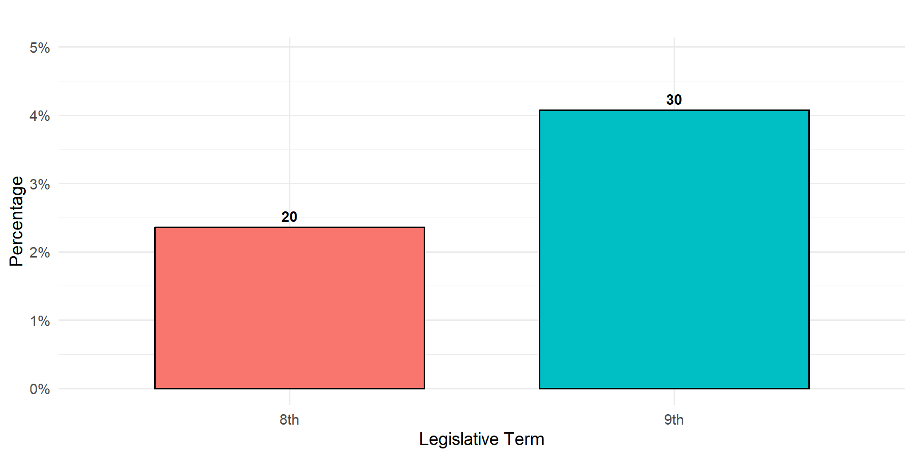
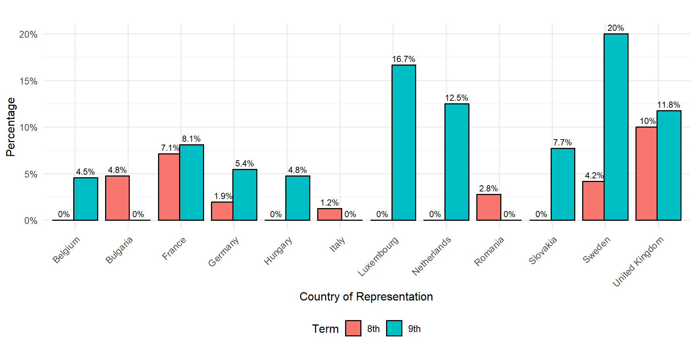

**Does Biography Matter? Minority Background, National
Anti-Discrimination Frameworks, and Legislative Attention in the
European Parliament**

Zeynep Mentesoglu Tardivo (University of Milan)

Federico Russo (University of Salento)

**ABSTRACT**

While the representative link between citizens and political elites is
under growing strain across Europe, migrant-origin and racialised
minorities remain underrepresented, raising a central question in the
literature on descriptive and substantive representation: whether, and
under what conditions, the presence of minority representatives
translates into legislative attention to concerns affecting these
groups. Existing research presents a complex picture. Theories of group
and gyroscopic representation suggest that shared experiences may
increase representatives' attention to issues affecting marginalised
groups, whereas constructivist approaches caution that biographies do
not automatically determine their priorities. Against this background,
this article examines whether Members of the European Parliament with
migratory or racialised minority backgrounds devote greater attention to
discrimination-related issues and whether this relationship varies
across national anti-discrimination policy contexts. To address these
questions, the study draws on the EUQuest project dataset, combining
approximately 180,000 written parliamentary questions from the eighth
and ninth European Parliament terms with original biographical data on
MEPs and country-level MIPEX anti-discrimination scores. Using Bayesian
multilevel count models, the study analyses MEP-year patterns in the
submission of written questions classified under CAP code 201, "Ethnic
Minority and Racial Group Discrimination", across 26 EU Member States
and the United Kingdom. Findings suggest that neither minority
background nor stronger anti-discrimination frameworks are independently
associated with greater attention at the relevant reference values.
However, their interaction is positive: minority-background MEPs devote
greater attention to discrimination-related issues where national
anti-discrimination frameworks are more developed. The analysis provides
new evidence with important implications for the study of representation
and inequality, showing that the link between minority presence and
legislative attention is neither automatic nor uniform, but depends on
the policy environment in which representation takes place.

**Keywords:** political representation; migrant-origin politicians;
anti-discrimination policy; legislative attention; European Parliament;
parliamentary questions; EUQuest; MIPEX;

**\
Introduction**

Whose demands are heard and reflected in political outcomes is a
fundamental question of democratic representation. Although
representation is commonly understood as an interactive process through
which societal preferences are communicated to and potentially taken up
by political elites, access to this process is unequally distributed
(Pitkin, 1967; Mansbridge, 2003; Saward, 2010; Wolkenstein & Wratil,
2021). A substantial literature demonstrates that inequalities in
socioeconomic resources, political participation, and access to
decision-makers can translate into unequal political influence, with the
preferences of more advantaged groups often receiving greater attention
from political elites (Gilens & Page, 2014; Peters & Ensink, 2015;
Elsässer et al., 2021; Schakel et al., 2020). Such inequalities are
difficult to reconcile with democratic principles of political equality,
according to which citizens should have comparable opportunities to
shape collective decisions (Dahl, 1989; Ingham, 2022; Sabl, 2015).

These broader inequalities in political voice and representation are
especially pronounced among migrants and their descendants, who often
face disadvantages at multiple stages of the representative process.
First, non-citizen migrants in Europe are often formally excluded from
electoral arenas (Arrighi & Bauböck, 2017), while migrant-origin
populations remain descriptively underrepresented within legislative
institutions (Auer et al., 2025; Dancygier et al., 2015). Recent
comparative evidence from Germany, Spain, the Netherlands, the United
Kingdom, and Switzerland shows that, despite some progress, the
proportion of immigrant-origin MPs generally remains below the
corresponding population share (Bergmann et al., 2025). This persistent
representation gap may reflect not only broader inequalities in
political recruitment but also discriminatory barriers within candidate
selection and electoral competition, including the disproportionately
low selection of migrant-origin aspirants and their placement in less
competitive constituencies or lower positions on electoral lists
(Holtkamp et al., 2023; English, 2022; Auer et al., 2025). This
underrepresentation may have consequences beyond descriptive inclusion
by reducing the likelihood that the experiences and concerns of
migrant-origin and racialised minorities receive sustained legislative
attention (Mansbridge, 1999; Saalfeld & Bischof, 2013; Sobolewska et
al., 2018).

Second, the disadvantages associated with political representation do
not necessarily disappear once migrant-origin politicians enter elected
office. Research on the Swedish parliament documents recurrent direct
and indirect discrimination against MPs with immigrant backgrounds, both
within the parliamentary workplace and in their interactions with the
public. (Albertsson & Erikson, 2025). These findings are reinforced by
the comparative REPCHANCE Europe (2025) study, in which migrant-origin
elected representatives reported experiencing discrimination, hate
speech, and tokenism, with women in particular describing intersecting
forms of racism and sexism. They also reported being expected, or
confined, to concentrate on migration and integration issues, even when
these areas fell outside their prior expertise or broader political
interests (Bergmann et al., 2025). In Germany and Switzerland, for
example, migrant-origin politicians described diversity within parties
and parliament as partly performative: migration-related portfolios were
frequently assigned to them, while their opportunities to demonstrate
expertise in other policy domains remained constrained. These findings
reveal an important ambiguity. Shared experiences of exclusion may
motivate migrant-origin representatives to raise discrimination-related
concerns, but institutional expectations may simultaneously
instrumentalise their backgrounds, restrict their policy roles, and
narrowly define the constituencies they are expected to represent.
Descriptive presence, in other words, does not automatically determine
whether---or under what conditions---the concerns of migrant-origin
populations receive substantive legislative attention.

Against this backdrop, this article investigates whether MEPs' migratory
or racialised minority backgrounds constitute a distinct biographical
channel of representation, increasing their likelihood of raising
discrimination-related issues in the European Parliament. In doing so,
it engages with a central puzzle between theories of group
representation and constructivist approaches to political
representation. While the former emphasise how descriptive presence may
advance substantive representation and social justice (Phillips, 1995,
2023; Williams, 1998; Mansbridge, 1999), constructivist accounts stress
that identities and group interests are not socially given but are
actively interpreted and constituted through representative claims
(Laclau, 2005; Urbinati, 2006; Saward, 2010). The article therefore does
not assume that minority background automatically translates into
particular legislative behaviour but examines whether biography
systematically shapes parliamentary attention. It further examines
whether legislative attention varies across national contexts according
to the prevalence of migration-related discrimination and, crucially,
whether this contextual relationship differs between MEPs with and
without migratory or racialised minority backgrounds. In this way, the
analysis assesses whether biography and national context operate
independently or interact in shaping parliamentary attention to
discrimination.

Empirically, the study links national anti-discrimination policy
contexts to individual legislative behaviour across 26 EU Member States
and the United Kingdom. At the country level, we use MIPEX
anti-discrimination scores, which capture the strength of legal
protections, equality policies, and institutional mechanisms addressing
ethnic, racial, religious, and nationality-based discrimination. At the
elite level, we draw on the EUQuest dataset, comprising approximately
180,000 written parliamentary questions tabled in the European
Parliament.

The European Parliament provides a particularly suitable setting for
examining the relationship between descriptive representation and
legislative behaviour. MEPs operate within a common supranational
institution while being elected in countries with different
anti-discrimination policy environments, allowing us to assess the
independent and interactive effects of representatives' biographies and
national contexts on parliamentary attention. Within this setting,
written questions are especially useful because they offer MEPs greater
individual discretion than more strongly party-disciplined activities
such as legislative voting (Russo & Wiberg, 2010; Mügge et al., 2019).

Finally, we link this legislative output to an original, hand-coded
biographical dataset identifying the first- and second-generation
migratory and racialised minority backgrounds of MEPs serving during the
eighth and ninth parliamentary terms (2014--2024). While numerous
studies have documented inequalities in political participation and
representation between migrant-origin and non-migrant populations, to
the best of our knowledge, this is the first to examine whether MEPs'
biographical backgrounds shape their attention to discrimination-related
issues while accounting for cross-national variation in
anti-discrimination policy contexts.

The remainder of the article is structured as follows. The next section
develops the theoretical framework and formulates the hypotheses. This
is followed by a discussion of the data, variable operationalisation,
and multilevel modelling strategy. The subsequent section presents the
empirical results, while the conclusion considers their theoretical
implications, outlines the study's contributions and limitations, and
proposes avenues for further research.

1.  **Theoretical Framework and Hypotheses**

Political representation concerns both *who representatives are* and
*what they do*. Descriptive representation refers to the presence of
members of particular social groups within political institutions,
whereas substantive representation concerns whether representatives
advance interests and concerns associated with those groups (Pitkin,
1967). Pitkin's original formulation treated descriptive representation
primarily as a matter of resemblance---of representatives "standing for"
others through shared characteristics---rather than acting on their
behalf. Theories of group representation and the politics of presence
subsequently challenged this separation, arguing that the inclusion of
historically marginalised groups can strengthen political equality and
democratic legitimacy while bringing previously overlooked experiences,
perspectives, and policy concerns onto institutional agendas (Phillips,
1995; Williams, 1998; Mansbridge, 1999).

A central tension nevertheless emerges within this literature. On the
one hand, persistent patterns of exclusion and inequality support the
need for marginalised groups to possess an institutional voice and make
political advocacy particularly important. Shared experiences of
disadvantage may provide representatives with knowledge of concerns that
dominant groups have historically overlooked. On the other hand,
descriptive presence does not automatically produce substantive
representation. Members of marginalised groups do not necessarily share
identical interests, political preferences, or interpretations of
collective concerns, and representatives may differ in their
identification with and commitment to particular constituencies
(Williams, 1998; Young, 2000; Dovi, 2002). Migratory or racialised
minority background should therefore be understood as a potential
representational resource rather than as an automatic predictor of
legislative behaviour.

Gyroscopic representation provides one mechanism through which biography
may shape political action. Whereas conventional accounts emphasise
party discipline, electoral incentives, and explicitly communicated
constituency demands, gyroscopic approaches suggest that representatives
also rely on internally held principles, understandings of interest, and
forms of "common sense" shaped by their personal experiences, social
positions, and political socialisation (Mansbridge, 2003; Burden, 2007).
Social background thus operates not as a deterministic guide independent
of strategic constraints, but as a cognitive lens through which
representatives interpret political problems and prioritise competing
issues. Shared experiences of migration, racialisation, exclusion, or
discrimination may consequently do more than generate symbolic affinity:
they may shape which forms of inequality representatives recognise as
politically salient and worthy of legislative attention (Sobolewska et
al., 2018).

Evidence concerning politicians' representational orientations is
consistent with this mechanism. Using the 2009 German Candidate Survey,
Coffé and Reiser (2018) find that candidates belonging to particular
social groups---including candidates with immigrant backgrounds---are
more likely to believe that members of their own group can represent
that group's interests more effectively. This belief appears to be
rooted mainly in identification with one's own group rather than in a
general commitment to descriptive representation. At the same time,
candidates with parliamentary experience express weaker support for
group representation, suggesting that institutional socialisation may
moderate biographically grounded orientations.

Constructivist theories provide an important qualification to the
biographical argument. They reject the assumption that identities and
group interests are socially given or pre-political and simply
transmitted by descriptive representatives. Rather, representatives
actively interpret the interests, identities, and constituencies they
claim to represent, adapting their claims to different audiences and
institutional settings (Laclau, 2005; Urbinati, 2006; Saward, 2010). The
political relevance of a particular characteristic consequently varies
across time, place, and context. Migrant-background MEPs must decide
which aspects of their biographies to emphasise, which constituencies to
address, and how discrimination-related concerns should be framed within
parliamentary arenas.

This perspective is particularly relevant for minority representatives
operating within mixed electorates. Such representatives may need to
mediate between minority concerns, broader constituency interests, party
positions, and multiple dimensions of their own identities (Saward,
2010, 2014; Bajpai, 2019). Migratory background may provide experiential
knowledge and connections to affected communities, but representatives
retain agency over whether and how those resources are translated into
legislative action. Biography is therefore conceptualised as a
disposition that may increase attention to discrimination, not as a
deterministic connection between identity and behaviour.

Empirical evidence indicates the presence of such a relationship between
representatives' backgrounds and legislative priorities. Studies of
German legislatures show that representatives with migratory backgrounds
devote greater attention to migration- and integration-related issues
than representatives without such backgrounds (Donovan, 2012; Wüst,
2014). Evidence from the British House of Commons similarly shows that
minority MPs submit more parliamentary questions concerning immigration
and ethnic-minority rights than comparable non-minority MPs (Saalfeld &
Bischof, 2013). Together with the evidence on candidates'
representational attitudes, these findings suggest that biography can
shape both how political actors understand representation and which
issues they prioritise, although its influence may remain conditioned by
party affiliation, ideology, institutional position, political
socialisation, and individual identification.

The form of legislative activity may also affect whether biographical
orientations become observable. In strongly party-disciplined activities
such as roll-call voting, party affiliation may leave relatively little
scope for differences associated with representatives' backgrounds.
Research instead finds clearer relationships between descriptive and
substantive representation in parliamentary questions, debates, and
committee activity, where legislators generally have greater discretion
to select and frame the issues they address (Bird, 2011; Celis, 2008;
Minta & Sinclair-Chapman, 2013; Saalfeld & Bischof, 2013; Toró, 2018).

Written parliamentary questions are therefore particularly suitable for
examining biographical representation in the European Parliament. They
provide individual MEPs with an instrument through which to raise
issues, request information, and signal political concern. Because
representatives must allocate attention across numerous competing policy
matters, submitting a question on discrimination reflects a decision to
prioritise that issue within their parliamentary activity. At the same
time, written questions may also serve strategic purposes.
Representatives can use them to demonstrate responsiveness, enhance
their individual reputations, and signal concern for constituency
interests, particularly because they face relatively low institutional
barriers and allow greater individual discretion than legislative voting
(Russo & Wiberg, 2010).

A discrimination-related parliamentary question demonstrates attention
to a concern relevant to migrant-origin and racialised populations. It
does not, however, necessarily show that an MEP explicitly claims to
represent those groups or consciously invokes their own biography as a
source of political authority. The analysis therefore treats such
questions as evidence of issue prioritisation rather than definitive
evidence of identity-based representative claims.

Taken together, these arguments suggest that representatives'
biographies may systematically shape legislative attention without
determining it uniformly. We therefore expect:

> **H1.** MEPs with migratory or racialised minority backgrounds are
> more likely than other MEPs to submit parliamentary questions
> addressing discrimination-related issues.

Representatives' biographies are not the only potential source of
legislative attention. MEPs are elected in national contexts that vary
in the strength of their anti-discrimination policy frameworks.
Policy-feedback theory suggests that public policies do not merely
reflect prior political demands; once enacted, they can restructure
subsequent political processes by shaping the resources, incentives,
information, and interpretive cues available to political actors
(Pierson, 1993). Mettler and Soss (2004) similarly emphasise that
policies can frame political agendas and social problems, define the
status and membership of affected groups, and structure opportunities
for political action.

Applied to anti-discrimination policy, more comprehensive legal
protections, enforcement mechanisms, and equality institutions may
generate both resource and interpretive effects. At the resource level,
stronger frameworks establish legal procedures, equality bodies,
expertise, and institutional venues through which discrimination-related
concerns can be articulated and scrutinised. At the interpretive level,
they signal that discrimination is a publicly recognised and legitimate
subject of political intervention, while providing representatives with
legal categories, information, and policy language through which to
understand and frame it. Stronger anti-discrimination frameworks may
therefore increase the visibility and political salience of
discrimination-related concerns among MEPs, irrespective of their own
backgrounds.

> **H2.** MEPs elected in countries with stronger anti-discrimination
> policy frameworks are more likely to submit parliamentary questions
> addressing discrimination-related issues.

Additionally, we anticipate that MEPs' biographical backgrounds
condition the relationship between national anti-discrimination policy
frameworks and parliamentary attention. Policy elites do not respond
uniformly to institutional contexts; they differ in how they interpret
the political relevance of established legal protections, equality
institutions, and policy debates (Ross & Staines, 1972; Jones &
Baumgartner, 2005; Joosten, 2024). In other words, the same
institutional resources and interpretive cues may be recognised and used
differently depending on representatives' experiences, identities, and
political orientations. MEPs with migratory or racialised minority
backgrounds may possess experiential knowledge, community ties, and
representational motivations that make them particularly attentive to
the opportunities created by stronger anti-discrimination frameworks.

Evidence from the comparative REPCHANCE Europe study shows that
politicians with migratory backgrounds frequently connect their
political aspirations to commitments to public service and social
justice, personal experiences of discrimination, critical events such as
anti-immigrant attacks, and mobilisation or recruitment by political
parties (Bergmann et al., 2025). These biographical resources may make
minority-background MEPs especially likely to recognise the relevance of
established legal protections, equality institutions, and
anti-discrimination policy debates. Stronger frameworks may consequently
facilitate their role as institutional conduits through which minority
concerns enter parliamentary agendas (Bajpai, 2019; Saalfeld & Bischof,
2013).

Accordingly, our third hypothesis is as follows:

> **H3.** The expected relationship between the strength of national
> anti-discrimination policy frameworks and MEP attention to
> discrimination-related issues is stronger among MEPs with migratory or
> racialised minority backgrounds than among other MEPs.

## Data

The empirical investigation draws primarily on data from the EUQuest
Project, which provides systematic information on issue attention and
representative characteristics in the European Parliament. EUQuest
comprises approximately 180,000 Questions for Written Answer submitted
between 1994 and 2024, classified into 20 policy topics using the
Comparative Agendas Project coding scheme. It also includes a
comprehensive dataset of all MEPs serving during this period, covering
their political and biographical characteristics and, most importantly
for this study, identifying those with a migratory or racialised
minority background. The present analysis focuses on MEPs elected in 26
EU Member States and the United Kingdom during the eighth and ninth
parliamentary terms, covering the period from 2014 to 2024.

The EUQuest data are complemented with country-level information from
the Migrant Integration Policy Index (MIPEX)[^1]. Specifically, we use
the MIPEX anti-discrimination policy score to measure the strength of
the legal and institutional framework protecting individuals from
discrimination based on racial or ethnic origin, religion, and
nationality. MIPEX anti-discrimination scores are available from 2007
onwards and are matched to MEPs according to their country of election
and the relevant observation year.

Because MIPEX assessments are not available annually for every country,
we construct both country-year and parliamentary-term measures. For each
observation, we retain the MIPEX assessment year used in the matching
procedure. This approach ensures transparency in the temporal alignment
of the data and captures both policy stability and changes in national
anti-discrimination frameworks during the period examined.

## Concepts and Measures

The operationalisation process was carried out as described below.

Regarding the dependent variable, *parliamentary attention to
discrimination* was measured as the annual number of Questions for
Written Answer submitted by each MEP and classified under Comparative
Agendas Project minor-topic code 201, "Ethnic Minority and Racial Group
Discrimination." Questions assigned to this category account for
approximately 1.1 per cent of all written questions submitted during the
eighth and ninth parliamentary terms. At least one such question was
submitted by 225 individual MEPs in the eighth legislature and by 124 in
the ninth.

The automated classification of parliamentary questions at the CAP
minor-topic level has an estimated accuracy of approximately 75 per
cent. Before running the analysis, questions assigned to code 201 were
therefore reviewed and further cleaned to improve the substantive
validity of the measure. In particular, questions referring exclusively
to discrimination against Christians or to cases occurring outside
Europe were excluded when they fell outside the substantive scope of the
study. For robustness, alternative specifications use a binary indicator
distinguishing whether an MEP submitted at least one
discrimination-related question and a term-level count of all such
questions submitted during each legislature.

The principal individual-level independent variable identifies *MEPs
with a migratory or racialised minority background*. Migratory
background is defined as being a first- or second-generation migrant
originating from a non-EU country outside the Global North. Roma MEPs
are also included because they belong to a racialised minority exposed
to persistent ethnic discrimination.

The European Parliament does not systematically collect information on
MEPs' ethnic or migratory backgrounds. Place of birth provides an
incomplete and potentially misleading proxy because it does not identify
second-generation MEPs and may classify individuals born abroad for
reasons unrelated to migration. The indicator was therefore constructed
through original biographical research based on publicly available
information concerning MEPs' personal and family backgrounds.

This procedure identified 20 MEPs with a migratory or racialised
minority background in the eighth legislature and 30 in the ninth. As
shown in Figure 1, both the number and the proportion of
minority-background MEPs increased between the two parliamentary terms,
although they continued to represent only a small share of all MEPs.

{width="4.91666447944007in"
height="2.4583333333333335in"}

**Figure 1.** MEPs with a migratory background by legislature

The European Network Against Racism provides a useful aggregate
benchmark. ENAR defines racialised-minority representatives as MEPs who
"either identify as non-white or identify as belonging (also) to a
non-EU country that is not in the Global North, or both" (ENAR 2024,
54). On this basis, ENAR estimates that racialised minorities accounted
for 3.3 per cent of MEPs in the eighth legislature and 4.5 per cent in
the ninth before the United Kingdom's withdrawal, corresponding to 28
and 39 MEPs respectively.

Our individual-level counts are therefore lower than ENAR's aggregate
estimates. Because ENAR does not publish the names of the MEPs included
in its classification, it is not possible to determine whether this
discrepancy results from differences in coding criteria, the population
counted, or individual classification decisions. ENAR's estimates are
consequently treated as an external descriptive benchmark rather than as
a direct validation of our indicator. Nevertheless, both sources
indicate that the descriptive representation of migrant-origin and
racialised minorities increased between the eighth and ninth
parliamentary terms, while remaining limited overall. This pattern is
consistent with the wider literature documenting their persistent
underrepresentation in European political institutions (Bloemraad, 2013;
Bloemraad & Schönwälder, 2013; Dancygier et al., 2015; Auer et al.,
2025).

The representation of MEPs with migratory or racialised minority
backgrounds also varied substantially across national delegations and
parliamentary terms, as shown in Figure 2.

{width="6.5in" height="3.250317147856518in"}

**Figure 2.** Percentage of MEPs with a migratory background by country

Regarding the country-level independent variable, the national
anti-discrimination policy context is measured using the
anti-discrimination component of the Migrant Integration Policy Index
(MIPEX). The indicator evaluates the extent to which national laws,
policies, enforcement mechanisms, and equality bodies protect
individuals against discrimination based on racial or ethnic origin,
religion, and nationality. Scores range from 0 to 100, with higher
values indicating more comprehensive and favourable anti-discrimination
frameworks. The measure captures the formal legal and institutional
context rather than the prevalence of discrimination or the
effectiveness of implementation in practice.

MIPEX scores are matched to each MEP-year according to the
representative's country of election and the observation year. When an
exact-year score is unavailable, the most recent preceding observation
is assigned; future scores are not used retrospectively. The original
MIPEX reference year is retained for each matched observation, allowing
the temporal alignment of the data to be verified and distinguishing
genuine policy changes from periods of stability. Appendix Table A1
reports the MIPEX scores and reference years applied to each country
during the period analysed.

To test the hypotheses, we estimated Bayesian zero-inflated negative
binomial generalised linear mixed models. This specification was chosen
because the dependent variable is an overdispersed count and contains a
large number of zero observations, corresponding to MEP-years in which
no discrimination-related question was submitted.

The models include a random intercept for each MEP to account for
repeated observations and unobserved individual differences. The fixed
effects comprise MEPs' migratory or racialised minority background,
gender, party family, LIBE Committee membership, the national misery
index, and the MIPEX anti-discrimination score. To test the conditional
hypothesis, we include an interaction between MEPs' minority background
and the MIPEX score. This interaction assesses whether the association
between the national anti-discrimination policy framework and
parliamentary attention to discrimination differs between
minority-background and other MEPs.

4.  **Findings**

Table 1 presents the posterior estimates from the Bayesian zero-inflated
negative binomial model. The analysis examines whether MEPs' migratory
or racialised minority backgrounds are associated with greater attention
to discrimination-related issues and whether this relationship varies
according to the strength of the anti-discrimination policy framework in
their countries of election.

The findings in the model indicate that our *H1* was not confirmed.
Although the estimated coefficient for minority background is positive
and therefore in the expected direction, its 95 per cent credible
interval includes zero (β = 0.327, 95% CrI \[−0.595, 1.151\]). Because
the model includes an interaction with the centred MIPEX score, this
coefficient represents the estimated difference between
minority-background and other MEPs in a country with an average level of
anti-discrimination policy protection. The result therefore does not
provide clear evidence that minority-background MEPs submit more
discrimination-related questions at the reference level of MIPEX. H1 is
consequently not supported as an unconditional expectation. This result
should not, however, be interpreted as evidence that MEPs' biographies
are unrelated to parliamentary attention. The positive interaction
reported in the model in Table 1 indicates that the association between
minority background and discrimination-related questioning varies
substantially across national policy contexts.

*H2* anticipated that MEPs elected in countries with stronger
anti-discrimination policy frameworks would devote greater parliamentary
attention to discrimination-related issues. The estimated coefficient
for the MIPEX score is close to zero, and its 95 per cent credible
interval includes zero (β = −0.0007, 95% CrI \[−0.013, 0.011\]). The
findings therefore provide no clear evidence that stronger national
anti-discrimination frameworks are independently associated with more
frequent discrimination-related questioning. H2 is consequently not
supported. This suggests that the formal recognition and
institutionalisation of anti-discrimination principles at the national
level do not, by themselves, uniformly translate into greater
parliamentary attention to discrimination in the European Parliament.

*H3* anticipated that the relationship between MEPs' migratory or
racialised minority backgrounds and discrimination-related parliamentary
attention would become stronger as national anti-discrimination policy
frameworks became more comprehensive. The interaction between minority
background and the centred MIPEX score is positive, and its 95 per cent
credible interval excludes zero (β = 0.0658, 95% CrI \[0.016, 0.117\]).
The findings therefore provide support for H3.

More specifically, the positive interaction indicates that the
difference in discrimination-related questioning between
minority-background and other MEPs increases as MIPEX scores rise.
Minority-background MEPs are thus more likely to devote parliamentary
attention to discrimination in countries where anti-discrimination
rights and institutions are more strongly developed.

**Table 1.** Posterior estimates from the Bayesian zero-inflated
negative binomial model

  ------------------------------------------------------------------------------
  **Hypothesis / predictor**                 **Estimate**   **95% credible
                                                            interval**
  ------------------------------------------ -------------- --------------------
  H1: Migratory or racialised minority       0.327          \[−0.595, 1.151\]
  background                                                

  H2: MIPEX anti-discrimination score        −0.0007        \[−0.013, 0.011\]

  H3: Minority background × MIPEX            0.0658\*       \[0.016, 0.117\]

  LIBE Committee membership                  0.429\*        \[0.079, 0.751\]

  Gender: male                               0.015          \[−0.191, 0.219\]
  ------------------------------------------------------------------------------

*Notes:* *Notes:* Entries report posterior coefficient estimates and 95%
credible intervals. \* indicates that the 95% credible interval excludes
zero. The stars are used as a visual summary of posterior evidence and
do not represent frequentist *p*-values. Because the model includes an
interaction, the coefficients for minority background and MIPEX
represent conditional effects at the reference value of the other
interacting variable.

Moreover, the model identifies additional institutional and political
correlates of discrimination-related parliamentary attention. LIBE
Committee membership is positively associated with the number of
discrimination-related questions submitted, and its 95 per cent credible
interval excludes zero (β = 0.429, 95% CrI \[0.079, 0.751\]). This
finding aligns with the committee's responsibilities for civil
liberties, fundamental rights, equality, migration, and
non-discrimination.

The evidence further indicates that party family influences the
relationship between MEPs' minority backgrounds and
discrimination-related parliamentary attention. The positive interaction
involving right-wing nationalist parties suggests that the difference
between minority-background and other MEPs is greater within this party
family. This finding should nevertheless be interpreted cautiously
because the dependent variable captures issue attention rather than the
position expressed in each question. Minority-background MEPs within
right-wing nationalist parties may raise discrimination-related issues
through supportive, critical, or oppositional framings. Further textual
analysis would therefore be necessary to establish the direction and
substantive content of this attention.

By contrast, the coefficient for male MEPs is close to zero, and its
credible interval includes zero (β = 0.015, 95% CrI \[−0.191, 0.219\]).
The model thus provides no clear evidence of a gender difference in
discrimination-related parliamentary questioning after accounting for
the other predictors.

Overall, the findings indicate that the parliamentary attention of
minority-background MEPs is not uniform across national contexts.
Neither minority background nor the MIPEX score has a clearly
identifiable independent association at the relevant reference values.
Their interaction, however, is positive and credibly different from
zero. This suggests that stronger national anti-discrimination
frameworks are associated with a more pronounced difference between
minority-background and other MEPs in their attention to
discrimination-related issues.

## Conclusion

Normative debates on political representation often assume, implicitly
or explicitly, that more proportional descriptive representation is
necessary for adequate substantive representation (Phillips, 1995;
Mansbridge, 1999). Yet whether representatives' social backgrounds
necessarily translate into attention to the concerns associated with
those backgrounds remains contested. This article set out to unpack this
relationship by examining whether MEPs with migratory or racialised
minority backgrounds devote greater parliamentary attention to
discrimination-related issues and whether this association depends on
the anti-discrimination policy frameworks of their countries of
election. By combining approximately 180,000 written parliamentary
questions with original biographical information on MEPs serving during
the eighth and ninth European Parliament legislatures and country-level
MIPEX scores, the study contributes to understanding when descriptive
presence translates into substantive issue attention and how this
process is conditioned by national institutional contexts.

More specifically, the article makes three contributions to the
literature. First, it advances debates on descriptive and substantive
representation by conceptualising migratory or racialised minority
background as a potential representational resource rather than as an
automatic determinant of legislative behaviour. In doing so, it brings
theories of group representation and the politics of presence (Phillips,
1995, Mansbridge, 1999, Williams, 1998) into dialogue with gyroscopic
(Mansbridge 1999, Burden 2007) and constructivist approaches (Laclau,
2005; Urbinati, 2006; Saward, 2010), which emphasise both the political
relevance of representatives' biographies and their agency in
interpreting and mobilising them.

Second, the study introduces national anti-discrimination policy
frameworks into the analysis of minority representation. Rather than
examining representatives' backgrounds and institutional contexts
separately, it assesses whether the relationship between biography and
legislative attention varies across national environments. This moves
the analysis beyond asking whether minority-background representatives
behave differently towards identifying the conditions under which such
differences emerge.

Third, the article makes an empirical and methodological contribution by
linking individual-level biographical information, legislative
behaviour, and time-varying country-level policy indicators across 26 EU
Member States and the United Kingdom. In doing so, it helps address
persistent data limitations in comparative research on migrant-origin
and racialised minority representatives and demonstrates the value of
written parliamentary questions for studying individual issue
prioritisation within a strongly party-structured supranational
institution.

The analysis provides the clearest evidence for a conditional
relationship between MEPs' biographical backgrounds and national
anti-discrimination policy contexts. Neither minority background nor the
MIPEX score displays a clearly identifiable association with
discrimination-related attention at the relevant reference values. Their
interaction, however, is positive, indicating that the difference
between minority- background and other MEPs becomes more pronounced as
national anti-discrimination frameworks become stronger.

This result is largely consistent with a conditional policy-feedback
interpretation. Stronger anti-discrimination frameworks may increase the
recognition and legitimacy of discrimination as a public problem and
supply institutional resources that create more favourable conditions
for minority-background MEPs to translate biographical experiences into
legislative attention (Pierson, 1993; Mettler & Soss, 2004). The
association between biography and parliamentary attention therefore
appears to be context-dependent rather than uniform. Because the
analysis is observational, however, the positive interaction should not
be interpreted as direct evidence that stronger anti-discrimination
institutions causally empower minority-background MEPs. Rather, it
documents the national policy contexts in which minority background is
more strongly associated with discrimination-related parliamentary
attention.

Finally, several limitations should be acknowledged. First, the
dependent variable captures attention to discrimination-related issues
rather than the direction or normative content of that attention.
Although questions assigned to CAP code 201 were reviewed and cleaned,
the higher propensity of right-wing nationalist MEPs to raise such
issues indicates that some questions may criticise anti-discrimination
policies rather than defend minority rights. Further textual analysis is
therefore needed to distinguish protective advocacy from critical,
oppositional, or strategically framed attention.

Second, the analysis is constrained by the limited availability of
reliable biographical information on MEPs. The study covers only the
eighth and ninth legislatures, within which relatively few
representatives were classified as having a migratory or racialised
minority background. This restricts statistical power and makes the
estimates potentially sensitive to the behaviour of a small number of
MEPs. Extending the dataset to the sixth and seventh legislatures would
improve temporal coverage and increase the number of minority-background
representatives observed, although reconstructing comparable
biographical information for earlier periods is considerably more
difficult.

Third, MIPEX measures the formal strength of national
anti-discrimination laws, equality policies, enforcement mechanisms, and
institutions, rather than their implementation in practice or the actual
prevalence of discrimination. Strong legal frameworks may coexist with
weak enforcement, limited access to justice, or persistent
discriminatory experiences. Future research could therefore combine
MIPEX with measures of experienced discrimination, implementation
capacity, and the activity of national equality bodies and civil-society
organisations.

In conclusion, this study offers valuable insights into the conditions
under which representatives' biographies become politically
consequential. While we anticipated that minority background and
stronger anti-discrimination frameworks would each independently
increase parliamentary attention to discrimination, the findings provide
the clearest evidence for their interaction. The political relevance of
representatives' biographies is therefore neither automatic nor uniform,
but conditioned by the national institutional context. These findings
underscore the need for further longitudinal and qualitative research to
identify the mechanisms through which anti-discrimination frameworks
enable or constrain the translation of biographical experiences into
legislative attention.

# References

Albertsson, M., & Erikson, J. (2025). Racism and gender in the
parliamentary workplace: Insight into immigrant-background MPs'
experiences of discrimination in Sweden. *Scandinavian Political
Studies, 48*(2), Article e70006.
<https://doi.org/10.1111/1467-9477.70006>

Arrighi, J.-T., & Bauböck, R. (2017). A multilevel puzzle: Migrants'
voting rights in national and local elections. European *Journal of
Political Research, 56*(3), 619--639.
<https://doi.org/10.1111/1475-6765.12176>

Auer, D., Portmann, L., & Tichelbaecker, T. (2025). Electoral
discrimination, party rationale, and the underrepresentation of
immigrant-origin politicians. *American Journal of Political Science,
69*(1), 19--35. <https://doi.org/10.1111/ajps.12817>

Bajpai, R. (2019). What do descriptive representatives describe?
Minority representative claims and the limits of shape-shifting.
Ethnicities, 19(5), 740--762. <https://doi.org/10.1177/1468796819847497>

Bergmann, H., Çelik, G., Runderkamp, Z., Vincent-Mory, C., Bobokova, J.,
Mugglin, L., Pamies, C., Ruedin, D., Wüst, A. M., Morales, L., D'Amato,
G., Mügge, L., Ihuoma, M., Bader, D., & Gerhard, S. (2025). *REPCHANCE
Europe: Drivers and obstacles to minority representation*. Robert Bosch
Stiftung.

Bird, K. (2011). Patterns of substantive representation among visible
minority MPs: Evidence from Canada's House of Commons. In K. Bird, T.
Saalfeld, & A. M. Wüst (Eds.), *The political representation of
immigrants and minorities: Voters, parties and parliaments in liberal
democracies* (pp. 207--229). Routledge.

Bloemraad, I. (2013). Accessing the corridors of power: Puzzles and
pathways to understanding minority representation. *West European
Politics, 36*(3), 652--670.
<https://doi.org/10.1080/01402382.2013.773733>

Bloemraad, I., & Schönwälder, K. (2013). Immigrant and ethnic minority
representation in Europe: Conceptual challenges and theoretical
approaches. *West European Politics, 36*(3), 564--579.
<https://doi.org/10.1080/01402382.2013.773724>

Celis, K. (2008). Studying women's substantive representation in
legislatures: When representative acts, contexts and women's interests
become important. *Representation, 44*(2), 111--123.
<https://doi.org/10.1080/00344890802079516>

Coffé, H., & Reiser, M. (2018). Political candidates' attitudes towards
group representation. The *Journal of Legislative Studies, 24*(3),
272--297. <https://doi.org/10.1080/13572334.2018.1516603>

Dahl, R. A. (1989). *Democracy and its critics*. Yale University Press.

Dancygier, R. M., Lindgren, K.-O., Oskarsson, S., & Vernby, K. (2015).
Why are immigrants underrepresented in politics? Evidence from Sweden.
*American Political Science Review, 109*(4), 703--724.
<https://doi.org/10.1017/S0003055415000404>

Donovan, B. (2012). Intersectionality and the substantive representation
of migrant interests in Germany. *German Politics and Society, 30*(4),
23--44. <https://doi.org/10.3167/gps.2012.300402>

Dovi, S. (2002). Preferable descriptive representatives: Will just any
woman, Black, or Latino do? *American Political Science Review, 96*(4),
729--743. <https://doi.org/10.1017/S0003055402000412>

Elsässer, L., Hense, S., & Schäfer, A. (2021). Not just money: Unequal
responsiveness in egalitarian democracies. *Journal of European Public
Policy, 28*(12), 1890--1908.
<https://doi.org/10.1080/13501763.2020.1801804>

English, P. (2022). High rejection, low selection: How "punitive
parties" shape ethnic minority representation. *Party Politics, 28*(2),
294--305. <https://doi.org/10.1177/1354068820973851>

European Network Against Racism. (2024, May 22). *Fact sheet:
Challenging the status quo—Diversity trends in the European
Parliament.*
<https://www.enar-eu.org/fact-sheet-challenging-the-status-quo-diversity-trends-in-the-european-parliament/>

Gilens, M., & Page, B. I. (2014). Testing theories of American politics:
Elites, interest groups, and average citizens. *Perspectives on
Politics, 12*(3), 564--581. <https://doi.org/10.1017/S1537592714001595>

Holtkamp, L., Garske, B., & Müller, F. (2023). Deskriptive
Repräsentation von Migranten bei den Bürgermeisterwahlen in NRW 2020. In
F. Bätge, K. Effing, K. Möltgen-Sicking, & T. Winter (Eds.),
*Integration in Kommunen: Bedeutung, aktuelle Entwicklungen und
Perspektiven aus Theorie und Praxis* (pp. 243--258). Springer VS.
<https://doi.org/10.1007/978-3-658-40965-4_13>

Ingham, S. (2022). Representative democracy and social equality.
*American Political Science Review, 116*(2), 689--701.
<https://doi.org/10.1017/S000305542100109X>

Jones, B. D., & Baumgartner, F. R. (2005). *The politics of attention:
How government prioritizes problems*. University of Chicago Press.

Joosten, M. (2024). Who influences whom? Inequality in the mutual
responsiveness between voters and elites. *Journal of European Public
Policy, 31*(11), 3761--3786.
<https://doi.org/10.1080/13501763.2023.2260810>

Laclau, E. (2005). *On populist reason*. Verso.

Mansbridge, J. (1999). Should Blacks represent Blacks and women
represent women? A contingent "yes." *The Journal of Politics, 61*(3),
628--657. <https://doi.org/10.2307/2647821>

Mansbridge, J. (2003). Rethinking representation. *American Political
Science Review, 97*(4), 515--528.
<https://doi.org/10.1017/S0003055403000856>

Mettler, S., & Soss, J. (2004). The consequences of public policy for
democratic citizenship: Bridging policy studies and mass politics.
*Perspectives on Politics, 2*(1), 55--73.
<https://doi.org/10.1017/S1537592704000623>

Minta, M. D., & Sinclair-Chapman, V. (2013). Diversity in political
institutions and congressional responsiveness to minority interests.
*Political Research Quarterly, 66*(1), 127--140.
<https://doi.org/10.1177/1065912911431245>

Mügge, L. M., van der Pas, D. J., & van de Wardt, M. (2019).
Representing their own? Ethnic minority women in the Dutch parliament.
*West European Politics, 42*(4), 705--727.
<https://doi.org/10.1080/01402382.2019.1573036>

Peters, Y., & Ensink, S. J. (2015). Differential responsiveness in
Europe: The effects of preference difference and electoral
participation. *West European Politics, 38*(3), 577--600.
<https://doi.org/10.1080/01402382.2014.973260>

Phillips, A. (1995). *The politics of presence*. Clarendon Press.

Pierson, P. (1993). When effect becomes cause: Policy feedback and
political change. *World Politics, 45*(4), 595--628.
<https://doi.org/10.2307/2950710>

Pitkin, H. F. (1967). *The concept of representation*. University of
California Press. <https://doi.org/10.1525/9780520340503>

Ross, R., & Staines, G. L. (1972). The politics of analyzing social
problems. *Social Problems, 20*(1), 18--40.
<https://doi.org/10.2307/799497>

Russo, F., & Wiberg, M. (2010). Parliamentary questioning in 17 European
parliaments: Some steps towards comparison. *The Journal of Legislative
Studies, 16*(2), 215--232. <https://doi.org/10.1080/13572331003740115>

Saalfeld, T., & Bischof, D. (2013). Minority-ethnic MPs and the
substantive representation of minority interests in the House of
Commons, 2005--2011. *Parliamentary Affairs, 66*(2), 305--328.
<https://doi.org/10.1093/pa/gss084>

Sabl, A. (2015). The two cultures of democratic theory: Responsiveness,
democratic quality, and the empirical--normative divide. *Perspectives
on Politics, 13*(2), 345--365.
<https://doi.org/10.1017/S1537592715000079>

Saward, M. (2010). *The representative claim*. Oxford University Press.

Saward, M. (2014). Shape-shifting representation. *American Political
Science Review, 108*(4), 723--736.
<https://doi.org/10.1017/S0003055414000471>

Schakel, W., Burgoon, B., & Hakhverdian, A. (2020). Real but unequal
representation in welfare state reform*. Politics & Society, 48*(1),
131--163. <https://doi.org/10.1177/0032329219897984>

Sobolewska, M., McKee, R., & Campbell, R. (2018). Explaining motivation
to represent: How does descriptive representation lead to substantive
representation of racial and ethnic minorities? *West European Politics,
41*(6), 1237--1261. <https://doi.org/10.1080/01402382.2018.1455408>

Toró, T. (2018). Ethnicization or de-ethnicization? Hungarian political
representation in the Romanian parliament*. Nationalities Papers,
46*(2), 219--236. <https://doi.org/10.1080/00905992.2017.1318122>

Urbinati, N. (2006). *Representative democracy: Principles and
genealogy*. University of Chicago Press.

Williams, M. S. (1998). *Voice, trust, and memory: Marginalized groups
and the failings of liberal representation*. Princeton University Press.

Wolkenstein, F., & Wratil, C. (2021). *Multidimensional representation.
American Journal of Political Science, 65*(4), 862--876.
<https://doi.org/10.1111/ajps.12563>

Wüst, A. M. (2014). A lasting impact? On the legislative activities of
immigrant-origin parliamentarians in Germany. *The Journal of
Legislative Studies, 20*(4), 495--515.
<https://doi.org/10.1080/13572334.2014.907601>

Young, I. M. (2000). *Inclusion and democracy*. Oxford University Press.

**Appendix A. MIPEX Anti-Discrimination Scores Used in the Analysis**

  --------------------------------------------------------------------------------------
  **Country**   **MIPEX score(s) applied by     **Minimum**   **Maximum**   **Temporal
                period**                                                    pattern**
  ------------- ------------------------------- ------------- ------------- ------------
  Austria       53 (2014--2024)                 53            53            Stable

  Belgium       100 (2014--2024)                100           100           Stable

  Bulgaria      100 (2014--2024)                100           100           Stable

  Cyprus        62 (2014--2024)                 62            62            Stable

  Czechia       64 (2014--2024)                 64            64            Stable

  Germany       70 (2014--2024)                 70            70            Stable

  Denmark       51 (2014--2024)                 51            51            Stable

  Estonia       48 (2014--2016); 52             48            52            Changed
                (2017--2024)                                                

  Spain         64 (2014--2021); 100            64            100           Changed
                (2022--2024)                                                

  Finland       94 (2014); 100 (2015--2024)     94            100           Changed

  France        79 (2014--2024)                 79            79            Stable

  United        94 (2014--2020)                 94            94            Stable
  Kingdom                                                                   

  Greece        67 (2014--2024)                 67            67            Stable

  Croatia       67 (2014--2016); 71             67            74            Changed
                (2017--2019); 67 (2020--2021);                              
                70 (2022); 74 (2023--2024)                                  

  Hungary       96 (2014--2020); 92             92            96            Changed
                (2021--2024)                                                

  Ireland       86 (2014--2016); 91 (2017); 94  86            94            Changed
                (2018--2019); 90 (2020--2024)                               

  Italy         78 (2014--2024)                 78            78            Stable

  Lithuania     51 (2014--2024)                 51            51            Stable

  Luxembourg    51 (2014--2016); 80             51            80            Changed
                (2017--2024)                                                

  Latvia        67 (2014--2024)                 67            67            Stable

  Netherlands   85 (2014--2024)                 85            85            Stable

  Poland        56 (2014--2024)                 56            56            Stable

  Portugal      100 (2014--2024)                100           100           Stable

  Romania       96 (2014--2019); 100            96            100           Changed
                (2020--2024)                                                

  Sweden        100 (2014--2024)                100           100           Stable

  Slovenia      84 (2014--2015); 90             84            96            Changed
                (2016--2019); 96 (2020--2024)                               

  Slovakia      79 (2014--2024)                 79            79            Stable
  --------------------------------------------------------------------------------------

*Notes:* MIPEX anti-discrimination scores range from 0 to 100, with
higher values indicating stronger and more favourable
anti-discrimination policy frameworks. Scores were matched by country of
election and MEP-year. Where an exact-year score was unavailable, the
most recent preceding score was assigned; future values were not used
retrospectively. The United Kingdom is reported through 2020, reflecting
its participation in the ninth European Parliament before withdrawal.
Where the source did not provide a new 2024 assessment, the latest
preceding score was carried forward according to the matching rule.

[^1]: [Anti-discrimination (2025) \| MIPEX
    2025](https://www.mipex.eu/antidiscrimination-2025)
